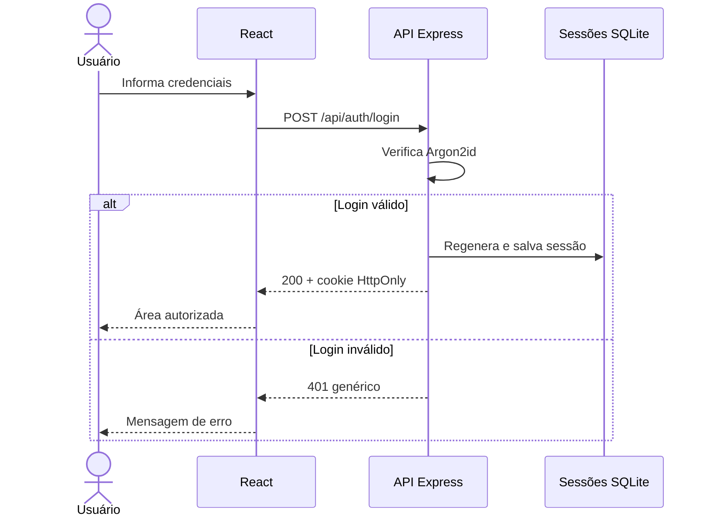

# ADR-0003 — Autenticação por sessão e cookie HttpOnly

**Status:** Adotada e implementada no escopo do projeto acadêmico
**Data da proposta:** 21/11/2026
**Última revisão:** 23/11/2026
**Escopo:** US-01 (MAT-6) e US-02 (MAT-7)
**Responsável pela decisão:** Thiago Silva

> **Nota de estado:** sessão no servidor, login, autorização, cookies e logout implementados e testados. Em 23/11/2026, foi acrescentada verificação CSRF de `Origin`/`Referer` no login e nas escritas autenticadas, com 10 testes de integração aprovados. **HTTPS real, continuidade após reinício e fluxo E2E de CSRF no navegador** ainda não foram comprovados. A adoção da decisão não equivale a certificação de segurança para produção.

## 1. Contexto e problema

O CINCoders possui usuários com perfil `ALUNO` ou `SECRETARIA`. O frontend React precisa acessar a API Express em várias requisições sem reenviar a senha, preservando a identidade e impedindo acesso indevido às operações de outro perfil.

O modelo `Usuario` registra `username`, `senhaHash` e `perfil`. O seed cria as credenciais de desenvolvimento usando `SEED_PASSWORD` e hash Argon2id. O login verifica esse hash; a senha e o campo `senhaHash` jamais devem ser enviados para o frontend.

Além da identificação, a aplicação precisa:

- invalidar uma sessão ao sair;
- aplicar autorização no servidor por perfil e titularidade de registros;
- lidar com sessão expirada ou invalidada durante a navegação;
- não expor segredos no repositório ou nas respostas HTTP.

## 2. Decisão técnica adotada

Utilizar **`express-session` com sessão armazenada no servidor e cookie de identificador de sessão**. O armazenamento persistente escolhido é SQLite por meio de `@bleed-believer/connect-sqlite3`.

### Configuração implementada

| Decisão | Configuração conhecida |
| --- | --- |
| Identificador de sessão | Cookie `cincoders.sid` |
| Proteção contra leitura via JavaScript | `HttpOnly: true` |
| Política de envio entre sites | `SameSite: "lax"` |
| Proteção adicional contra CSRF | Verificação de `Origin` ou `Referer` em métodos de escrita autenticados e no login |
| Origem do frontend permitida | `FRONTEND_ORIGIN`, padrão `http://localhost:5173`, compartilhada com CORS |
| Cookie em produção | `Secure: true` quando `NODE_ENV=production` |
| Tempo de expiração | 8 horas (`maxAge`) |
| Segredo de assinatura | Variável local `SESSION_SECRET`, mínimo de 32 caracteres |
| Fixação de sessão | Regenerar ID após login válido |
| Logout | Destruir sessão no armazenamento e limpar cookie |
| Sessões em desenvolvimento | Arquivo `sessions.db` |
| Sessões em testes | Arquivo `sessions.test.db` quando `NODE_ENV=test` |
| Senhas | Hash Argon2id |
| Controle de acesso | Middleware de autenticação/perfil e verificação de titularidade nos serviços |

Os arquivos SQLite de sessão não são os mesmos que armazenam os dados acadêmicos do Prisma. O `MemoryStore` padrão não é utilizado como armazenamento final.

**Importante:** configurar `Secure` em produção é uma medida implementada, mas seu funcionamento real em HTTPS não foi comprovado pelos testes locais em HTTP.

## 3. Funcionamento da solução

1. O usuário envia `username` e `senha` para `POST /api/auth/login`.
2. O backend busca o usuário, compara a senha com Argon2id e rejeita credenciais inválidas com mensagem genérica (`401`).
3. Após autenticação, o servidor regenera o identificador, associa a identidade à sessão, persiste a sessão e emite o cookie.
4. O frontend usa o cookie nas chamadas autenticadas; o backend obtém a identidade a partir da sessão.
5. Rotas restritas exigem `ALUNO` ou `SECRETARIA`. Nas operações do aluno, a vinculação ao registro acadêmico vem do usuário autenticado, não de um ID arbitrário enviado pelo navegador.
6. `POST /api/auth/logout` invalida a sessão armazenada e instrui o navegador a remover o cookie.
7. Quando uma chamada protegida recebe `401`, o cliente HTTP compartilhado encaminha o usuário à tela de login, respeitando as exceções de `/api/auth/login` e `/api/auth/me`.
8. Em `POST`/`PATCH`/`PUT`/`DELETE` com sessão (e no login), o middleware recusa `Origin` diferente da origem configurada; na ausência desse cabeçalho, aceita somente `Referer` cuja origem corresponda. Sem origem verificável, retorna `403`. Requisições `GET`, `HEAD` e `OPTIONS` não são bloqueadas por essa regra.

### Fluxo resumido

## 4. Alternativas consideradas

| Alternativa | Vantagens | Custos e riscos | Decisão |
| --- | --- | --- | --- |
| **Sessão no servidor + cookie** | Revogação centralizada, pouco dado no cliente, compatível com a estrutura local | Armazenamento persistente, CSRF e configuração de cookie | **Escolhida** |
| JWT no cliente | Pode evitar consulta a armazenamento central em determinadas arquiteturas | Revogação, duração e armazenamento seguro requerem estratégia adicional | Não adotada |
| Login sem senha | Permitido como simplificação pelo enunciado | Não comprova posse da conta e enfraquece a segurança | Não adotado |

**Motivo:** para uma aplicação acadêmica pequena com SQLite e dois perfis, a sessão no servidor oferece um caminho simples para invalidar acessos e concentrar a autorização.

## 5. Consequências da decisão

### No frontend

- Usar `credentials: "include"` quando necessário para enviar o cookie à API configurada.
- Consultar a sessão para direcionar o perfil à área correspondente.
- Não guardar senha ou hash em estado persistente do navegador.
- Reagir a `401` em chamadas protegidas, encaminhando ao login.
- Evitar loops de redirecionamento nas chamadas de login e de consulta inicial da sessão.

### No backend

- Configurar CORS com origem do frontend e credenciais, sem usar `*` como origem de respostas com cookies.
- Validar os dados do login e manter resposta genérica para credenciais inválidas.
- Proteger rotas por perfil e por propriedade acadêmica.
- Garantir que o logout invalide a sessão no armazenamento.
- Manter `SESSION_SECRET` e arquivos de sessão fora do Git.
- Manter a verificação de origem contra CSRF nas requisições mutáveis e testar qualquer nova origem autorizada. `SameSite=Lax` é uma camada adicional, não substitui a verificação nem dispensa análise para produção.

### Na manutenção e implantação

- O segredo precisa permanecer compatível entre reinícios para validação de cookies emitidos anteriormente.
- A implantação HTTPS deve considerar configuração de proxy, TLS e cookies seguros.
- O armazenamento de sessões precisa de persistência e política de retenção/limpeza apropriadas à implantação escolhida.
- Testes que modificam dados devem usar o banco de teste separado; a sessão também usa `sessions.test.db` sob `NODE_ENV=test`.

## 6. Evidências da implementação

| Evidência | Resultado informado |
| --- | --- |
| `apps/api/tests/auth.test.ts` | 8 testes de login, sessão, cookies, logout e regeneração aprovados |
| `apps/api/tests/auth.middleware.test.ts` | 3 testes de autorização por perfil aprovados |
| `apps/api/tests/csrf.test.ts` | 10 testes de integração de origem confiável, externa, ausente, `null`, `Referer`, login, `POST`, `PATCH` e `GET` aprovados |
| Autorização por titularidade | Exercitada por testes de matrícula, cancelamento, consultas, progresso e histórico |
| `apps/web/src/pages/LoginPage.test.tsx` | 4 testes da interface de login aprovados |
| `apps/web/src/routes/AppRoutes.test.tsx` | 4 testes de proteção e navegação de rotas aprovados |
| `apps/web/src/components/LogoutButton.test.tsx` | 3 testes de logout aprovados |
| `apps/web/src/api/client.test.ts` | 3 testes adicionais do cliente HTTP, incluindo tratamento de `401`, aprovados conforme relato |
| Teste manual com duas abas | Sessão invalidada em uma aba leva a outra ao login ao receber `401`; informado como aprovado |

**Checkpoint global atualizado em 23/11/2026:** API **143/143 testes em 12 arquivos** após T-32; frontend **95/95 testes em 12 arquivos**. Total: **238 testes automatizados** em duas suítes independentes, não uma suíte E2E.

## 7. Riscos residuais e recomendações para produção

| Verificação | Situação conhecida | Critério de fechamento |
| --- | --- | --- |
| Persistência após **reiniciar o processo** | Banco de sessões criado; ensaio com mesmo cookie ainda não documentado | Login, reinício da API mantendo banco/segredo e `GET /api/auth/me` autenticado sem novo login |
| Cookie `Secure` sobre HTTPS | Configuração de produção presente, sem teste HTTPS informado | Validar atributos e comportamento em ambiente HTTPS |
| CSRF | Validação de `Origin`/`Referer` implementada e aprovada em 10 testes HTTP | Complementar com teste E2E em navegador e reavaliar proteção por token em implantação com múltiplas origens |
| Expiração real após 8 horas | `maxAge` configurado; expiração por relógio não testada | Confirmar recusa de cookie expirado e navegação ao login |
| Sessão revogada em outra aba | Correção funcional e teste manual relatados | **Concluído funcionalmente**, sem equivaler ao ensaio de expiração por tempo |
| Privacidade acadêmica | Testes de titularidade nas funcionalidades implementadas | Manter testes de regressão ao alterar endpoints |

Estas verificações devem ser documentadas com precisão, sem confundir **configurado**, **implementado**, **testado** e **implantado**.

## 8. Resultado da decisão e evolução futura

O registro inicial condicionava a aceitação à seleção de um armazenamento persistente e à validação da autenticação. A solução adotada usa sessões SQLite e já foi exercitada com os testes funcionais descritos:

1. **Armazenamento persistente selecionado:** `@bleed-believer/connect-sqlite3`, sem `MemoryStore`.
2. **Login e autorização testados:** autenticação, senha incorreta, perfis, cookie, regeneração e logout.
3. **Comportamento da interface testado:** login, rotas por perfil e redirecionamento após `401` de sessão invalidada.
4. **Limites reconhecidos:** não existe evidência de verificação específica de HTTPS, expiração cronometrada, sessão mantida após reiniciar o processo nem fluxo E2E de CSRF em navegador; a verificação de origem foi testada por HTTP.

**Decisão final para a entrega acadêmica:** manter `express-session` com SQLite, cookie HttpOnly e verificação de origem nas escritas autenticadas; documentar os limites restantes como recomendações para implantação em produção, sem declará-los testados. Isso fecha o registro da escolha arquitetural para o código entregue, sem prometer garantias inexistentes.

Uma eventual mudança para JWT ou outra estratégia requer nova ADR ou revisão explícita desta decisão, não apenas uma alteração de código.

## 9. Referências

- [Autenticação e autorização — implementação](../arquitetura/autenticacao.md)
- [Visão geral da arquitetura](../arquitetura/visao-geral.md)
- [Requisitos e backlog](../requisitos-e-backlog.md)
- [Plano de testes](../testes/plano-de-testes.md)
- [Checklist de entrega](../entrega-checklist.md)
