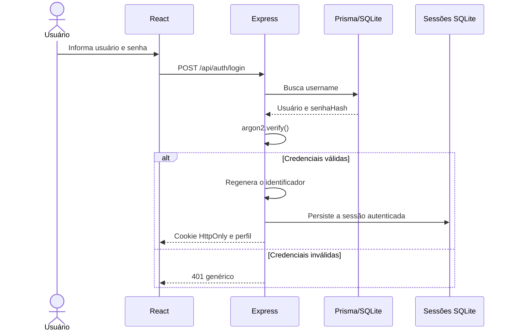

# Autenticação e autorização — CINCoders

**US-01:** Jira MAT-6

**Estado:** Em implementação — login, sessão armazenada em SQLite e autorização por perfil implementados e testados.

**Validação automatizada:** 11 testes aprovados em 21/11/2026 (8 de autenticação e 3 de autorização).

**ADR relacionada:** `docs/adr/0003-autenticacao-por-sessao.md` (status: **Proposta**).

**Atualizado em:** 21/11/2026.

## Requisito

O sistema deve autenticar usuários por `username` e senha e diferenciar `ALUNO` de `SECRETARIA`. Usuários não autenticados não podem acessar rotas protegidas. Cada aluno só pode acessar seus próprios dados acadêmicos.

## Dados e credenciais

O modelo `Usuario` tem `id`, `username` único, `nome`, `senhaHash` e `perfil`. Quando o perfil é `ALUNO`, o registro `Aluno` relaciona esse usuário a um curso. O identificador acadêmico é um ID interno numérico, não o `username`.

- O seed cria `secretaria`, `aluno.si`, `aluno.cc`, `aluno.ec` e `aluno.si2`.
- A senha de desenvolvimento vem da variável local `SEED_PASSWORD` e não deve constar neste documento ou no Git.
- O seed usa `argon2.hash()` (Argon2id); o login usa `argon2.verify(hash, senha)`.
- `senhaHash` jamais deve ser enviado ao frontend.

## Fluxo de autenticação implementado



O diagrama resume o fluxo implementado e parcialmente validado pelos testes HTTP. O React ainda está planejado; os testes atuais exercitam diretamente a API com Supertest. A persistência do registro de sessão em SQLite foi configurada, mas a evidência explícita de continuidade após reiniciar o processo ainda deve ser registrada.

## Endpoints implementados

| Método | Endpoint | Entrada/saída resumida | Situação |
| --- | --- | --- | --- |
| `POST` | `/api/auth/login` | Recebe `{ username, senha }`; em sucesso, cria sessão e retorna objeto `usuario` com `{ id, username, nome, perfil }` | Implementado e testado |
| `GET` | `/api/auth/me` | Retorna a identidade da sessão (`id`, `username`, `perfil`) ou `401` | Implementado e testado |
| `POST` | `/api/auth/logout` | Destrói sessão, instrui a limpeza do cookie e responde `204` | Implementado e testado |
| `GET` | `/api/health` | Verificação pública do servidor | Implementado e verificado manualmente |

Eventuais mudanças nesses contratos devem ser acompanhadas de atualização dos testes e da documentação. As respostas não devem expor `senhaHash` nem indicar se um `username` existe.

## Estrutura e responsabilidades

| Arquivo | Responsabilidade | Estado conhecido |
| --- | --- | --- |
| `src/config/database.ts` | Cria e exporta o Prisma Client com adaptador SQLite | Implementado |
| `src/modules/auth/auth.service.ts` | Busca `username`, verifica senha com Argon2id e retorna dados não sensíveis | Implementado e exercitado pelos testes de integração |
| `src/config/session.ts` | Configura cookies e armazenamento de sessões em SQLite | Implementado; persistência após reinício requer evidência específica |
| `src/modules/auth/auth.controller.ts` | Valida entrada HTTP, gerencia sessão e status | Implementado e testado |
| `src/modules/auth/auth.routes.ts` | Expõe as rotas de login, identidade e logout | Implementado e testado |
| `src/middlewares/auth.middleware.ts` | Exige autenticação e verifica perfil autorizado | Implementado e testado |
| `src/types/express-session.d.ts` | Define o formato de `req.session.usuario` no TypeScript | Implementado |
| `tests/auth.test.ts` | Testes de login, sessão, cookies e logout | 8 testes aprovados |
| `tests/auth.middleware.test.ts` | Testes de autorização por perfil | 3 testes aprovados |

## Controles de segurança

1. **Hash:** comparar senhas com `argon2.verify`; não salvar nem registrar senhas em logs.
2. **Falha genérica:** retornar `401` para credenciais inválidas; não diferenciar usuário inexistente de senha errada.
3. **Sessão:** cookie `HttpOnly`, `SameSite=Lax` e `Secure` em HTTPS; configurar tempo limite e segredo por ambiente.
4. **Fixação de sessão:** regenerar identificador após login bem-sucedido.
5. **Logout:** destruir a sessão no armazenamento e limpar o cookie com opções compatíveis.
6. **Persistência:** `express-session` utiliza `@bleed-believer/connect-sqlite3` com `better-sqlite3`, substituindo o `MemoryStore`. Os dados acadêmicos não são armazenados no banco de sessões.
7. **CSRF:** avaliar proteção de requisições mutáveis que usam cookies, além de `SameSite`.
8. **Autorização:** verificar perfil (`SECRETARIA`/`ALUNO`) em todas as rotas protegidas; recuperar o `alunoId` a partir da sessão e nunca confiar no ID fornecido pelo cliente para consultar dados privados.
9. **CORS:** permitir explicitamente a origem do frontend e credenciais; não usar `*` com cookies.
10. **Erros e observabilidade:** não expor stack traces, segredos nem hashes em respostas.

### Armazenamento das sessões

- `sessions.db`: sessões do ambiente de desenvolvimento.
- `sessions.test.db`: sessões utilizadas nos testes automatizados (`NODE_ENV=test`).
- O cookie `cincoders.sid` armazena o identificador da sessão; os dados autenticados permanecem no servidor.
- `SESSION_SECRET` é configurado por variável de ambiente e precisa permanecer constante durante reinícios para que cookies anteriores possam ser validados.
- O cookie expira em oito horas conforme a configuração atual (`maxAge`).
- Os arquivos `.db` e auxiliares (`.db-wal`, `.db-shm`, `.db-journal`), bem como `.env`, não devem ser versionados.

**Observação:** a criação de `sessions.db` e `sessions.test.db` foi confirmada com `Test-Path`, mas a criação dos arquivos, isoladamente, não demonstra persistência da sessão após reinício. A comprovação exige login, reinício da API e consulta a `/api/auth/me` usando o mesmo cookie sem novo login.

### Segurança: o que falta verificar

- O atributo `Secure` está configurado para `NODE_ENV=production`, mas ainda não foi validado em HTTPS; em HTTP local não se espera esse atributo.
- `SameSite=Lax` reduz alguns riscos, porém não substitui uma proteção contra CSRF nas operações que alteram dados.
- A autorização por **propriedade dos registros acadêmicos** depende dos futuros endpoints de matrícula, histórico e progresso; verificar o `alunoId` obtido do usuário autenticado, não apenas um ID fornecido pelo cliente.

## Critérios Gherkin

```gherkin
Funcionalidade: Login e controle de acesso

  Cenário: Login válido
    Dado que existe um usuário com senha cadastrada
    Quando informa username e senha corretos
    Então a API cria uma sessão válida
    E retorna seu perfil sem senhaHash

  Cenário: Login inválido
    Quando informa credenciais incorretas
    Então a API responde com status 401
    E não informa qual credencial está incorreta

  Cenário: Usuário inexistente
    Quando informa um username inexistente e qualquer senha
    Então a API responde com status 401
    E apresenta a mesma mensagem genérica de credenciais inválidas

  Cenário: Usuário não autenticado
    Dado que não existe uma sessão válida
    Quando solicita uma rota protegida
    Então a API responde com status 401

  Cenário: Aluno tenta acessar registros de outro aluno
    Dado que um aluno está autenticado
    Quando solicita um registro acadêmico pertencente a outro aluno
    Então a API nega o acesso

  Cenário: Logout
    Dado que o usuário está autenticado
    Quando solicita o logout
    Então a sessão é invalidada
    E uma nova chamada a /api/auth/me retorna 401

  Cenário: Cookie protegido
    Dado que existe um usuário com credenciais válidas
    Quando realiza login
    Então o cookie da sessão possui HttpOnly e SameSite=Lax

  Cenário: Sessão após reinício da API
    Dado que o usuário realizou login e recebeu um cookie válido
    Quando a API é reiniciada mantendo o segredo e o banco de sessões
    Então /api/auth/me continua autenticado sem um novo login
```

## Testes de autenticação e autorização

### Evidência automatizada — 21/11/2026

Executados com Vitest 5.1.1 e Supertest, utilizando o banco SQLite de teste:

| Arquivo / categoria | Testes | Resultado |
| --- | ---: | --- |
| `tests/auth.test.ts` — autenticação, sessão e cookies | 8 | Aprovados |
| `tests/auth.middleware.test.ts` — autorização por perfil | 3 | Aprovados |
| **Total** | **11** | **11 aprovados; 0 falhas** |

**Comando da suíte completa:** `pnpm exec vitest run`.

### Cenários automatizados aprovados

- [x] `/api/auth/me` sem autenticação retorna `401`.
- [x] Senha incorreta retorna `401` com mensagem genérica.
- [x] Login de `aluno.si` retorna perfil `ALUNO`, sem `senhaHash`, e mantém sessão válida.
- [x] Logout invalida a sessão; `/me` posterior retorna `401`.
- [x] Username inexistente retorna `401` com a mesma mensagem genérica.
- [x] Cookie criado no login inclui `HttpOnly` e `SameSite=Lax`.
- [x] Novo login regenera o identificador da sessão (comparação entre dois logins).
- [x] Logout envia instrução de limpeza do cookie.
- [x] Cliente não autenticado recebe `401` em rota protegida.
- [x] Aluno recebe `403` em rota exclusiva da secretaria.
- [x] Secretaria recebe `200` em rota autorizada.

**Limite da evidência de autorização:** os três últimos cenários usam uma rota criada somente para os testes; os endpoints administrativos de produção ainda não foram validados.

### Testes manuais e configuração

| Teste | Evidência / resultado |
| --- | --- |
| Login de `aluno.si` | HTTP 200 e perfil `ALUNO` |
| Consulta a `/api/auth/me` com cookie válido | Usuário autenticado retornado |
| Logout e nova consulta a `/me` | Acesso negado corretamente (`401`) |
| `Test-Path .\sessions.db` | `True` — arquivo criado |
| `Test-Path .\sessions.test.db` | `True` — arquivo de testes criado |
| Consulta a `/me` depois de reiniciar a API | Aguardando registro explícito do resultado sem novo login |

### Testes e verificações pendentes

- [ ] Login automatizado com `aluno.cc`, `aluno.ec` e `aluno.si2`.
- [ ] Confirmar persistência da sessão após reiniciar a API usando o mesmo cookie.
- [ ] Verificar `Secure` em ambiente HTTPS de produção.
- [ ] Definir e validar proteção contra CSRF nas requisições que alteram estado.
- [ ] Testar expiração da sessão e impossibilidade de reutilizar o cookie expirado.
- [ ] Impedir que um aluno consulte registros acadêmicos de outro aluno quando os endpoints existirem.

## Resultados da implementação — 21/11/2026

**Funcionalidades comprovadas:** validação Argon2id, login, consulta de sessão, logout, autorização por perfil, atributos `HttpOnly`/`SameSite=Lax`, troca de ID entre logins e limpeza de cookie.

**Situação:** autenticação com 11 testes aprovados; o armazenamento persistente SQLite está integrado e os arquivos de sessão foram criados, mas os controles de CSRF/HTTPS e a autorização por propriedade acadêmica ainda não foram integralmente validados.

## Pendências para a entrega e Definition of Done

- [x] Endpoints de login, `/me` e logout implementados.
- [x] Middleware de autenticação e autorização por perfil implementado.
- [x] Testes automatizados de autenticação e autorização aprovados (11/11).
- [x] Armazenamento de sessões em SQLite configurado, sem `MemoryStore`.
- [x] Testes de `HttpOnly`, `SameSite=Lax`, regeneração do ID e limpeza de cookie aprovados.
- [ ] Registrar evidência do cenário de reinício do servidor.
- [ ] Revisar e testar CSRF nas rotas mutáveis.
- [ ] Validar `Secure` em HTTPS e testar os demais usuários do seed.
- [ ] Verificar isolamento de dados acadêmicos quando as rotas correspondentes estiverem implementadas.
- [ ] Atualizar `docs/testes/plano-de-testes.md`, Sprint 1 e ADR-0003 conforme as decisões finais.
- [ ] Verificar commit, push e atualização do Jira MAT-6.

**Status da US-01:** em andamento. A ADR-0003 permanece **Proposta** até a conclusão da revisão de segurança.