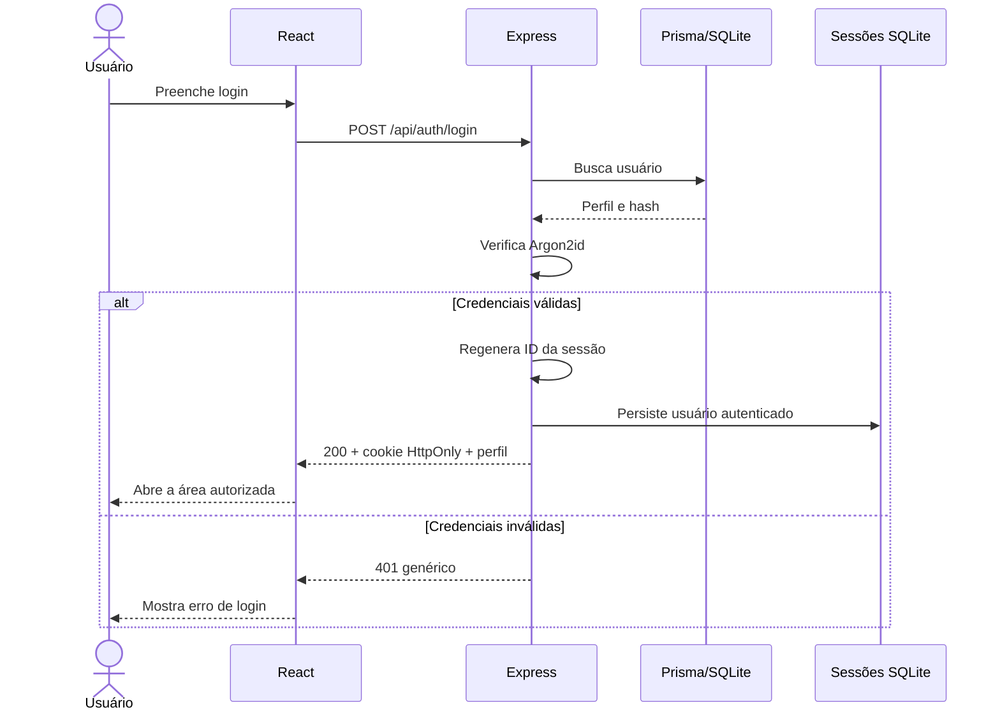

# Autenticação e autorização — CINCoders

**Histórias relacionadas:** US-01 (autenticação, Jira MAT-6) e US-02 (interface e controle de acesso, Jira MAT-7)
**Atualizado em:** 23/11/2026
**Estado funcional:** implementado e testado; há verificações de segurança complementares ainda não comprovadas
**ADR:** [0003 — Autenticação por sessão](../adr/0003-autenticacao-por-sessao.md) — decisão técnica adotada e limites de segurança registrados.

> **Atualização em relação à versão de 21/11:** login, rotas por perfil, sessão expirada e logout estão implementados no React. Os endpoints acadêmicos aplicam autorização por perfil/titularidade. Em 23/11, a proteção CSRF por origem foi adicionada e testada; HTTPS e continuidade de sessão após reinício ainda não foram verificados.

## 1. Requisito e atores

O usuário informa `username` e senha. O backend verifica a identidade e cria uma sessão; o frontend o encaminha à área do perfil `ALUNO` ou `SECRETARIA`. Operações protegidas exigem autenticação, e cada perfil só acessa funções autorizadas.

- **ALUNO:** consulta ofertas, matrículas próprias e histórico de cancelamentos, realiza/cancela matrículas e acompanha o progresso de seu curso.
- **SECRETARIA:** consulta e administra disciplinas, professores e turmas, inclusive a capacidade das turmas.
- Um aluno não pode selecionar outro `alunoId` para acessar dados privados; a identidade acadêmica é derivada do usuário autenticado na sessão.

## 2. Identidades e dados iniciais

O modelo `Usuario` registra `id`, `username` único, `nome`, `senhaHash` e `perfil`. Um usuário `ALUNO` possui associação ao seu registro acadêmico e curso.

O seed inclui:

| Perfil | Usuários de desenvolvimento |
| --- | --- |
| Secretaria | `secretaria` |
| Aluno | `aluno.si`, `aluno.cc`, `aluno.ec` e `aluno.si2` |

- A senha comum de desenvolvimento é definida em `SEED_PASSWORD` no `apps/api/.env` local, com no mínimo 12 caracteres.
- As senhas são derivadas com Argon2id no seed e verificadas com `argon2.verify()` durante o login.
- Não inserir senha real, `SESSION_SECRET` ou `senhaHash` em documentação, testes versionados, capturas ou logs.
- O arquivo `.env.example` serve de modelo e deixa as variáveis sensíveis vazias.

## 3. Fluxo implementado



Após login, requisições autenticadas incluem o cookie de sessão. O servidor obtém a identidade da sessão e o middleware exige o perfil correspondente. O logout destrói a sessão no armazenamento, limpa o cookie e encerra o acesso.

### Sessão expirada ou invalidada

Foi corrigido um comportamento observado manualmente: ao sair da conta em uma aba e tentar usar outra aba, a segunda ainda renderizava a área autenticada e exibia `Usuário não autenticado.`. O cliente HTTP compartilhado (`apps/web/src/api/client.ts`) passou a tratar respostas `401` de chamadas protegidas, encaminhando à tela de login.

**Exceções importantes:** o próprio `/api/auth/login` e a verificação inicial `/api/auth/me` precisam tratar `401` conforme seu contexto; a implementação deve preservar essas exceções para não provocar navegação indevida.

A correção foi informada como aprovada nos testes manuais e em três testes adicionais dedicados ao cliente HTTP. Não confundir essa evidência com um teste temporizado real de expiração do cookie após oito horas.

## 4. Contratos HTTP

| Método | Rota | Objetivo | Resultado esperado |
| --- | --- | --- | --- |
| `POST` | `/api/auth/login` | Recebe `username` e `senha` | Em sucesso, cria sessão e retorna identidade/perfil sem `senhaHash`; credenciais inválidas geram `401` |
| `GET` | `/api/auth/me` | Consulta sessão atual | Identidade autorizada ou `401` |
| `POST` | `/api/auth/logout` | Invalida sessão e cookie | `204` |
| `GET` | `/api/health` | Consulta pública de saúde da API | Endpoint público de verificação |

As rotas das funcionalidades acadêmicas são documentadas em [visão geral da arquitetura](visao-geral.md) e no [README](../../README.md). Os endpoints são protegidos conforme o perfil e a titularidade dos dados.

### Regras de resposta

1. Rejeitar usuário não autenticado com `401`.
2. Rejeitar usuário autenticado com perfil não autorizado com `403`.
3. Evitar diferenciar “usuário inexistente” de “senha incorreta” na resposta de login.
4. Não expor `senhaHash`, tokens, segredos, stack traces ou dados acadêmicos de terceiros.
5. Validar propriedades de registros no backend, independentemente do estado dos botões no frontend.

## 5. Componentes e responsabilidades

| Arquivo | Responsabilidade |
| --- | --- |
| `apps/api/src/config/database.ts` | Inicializa Prisma com adaptador SQLite |
| `apps/api/src/config/session.ts` | Configura cookie, segredo e armazenamento persistente de sessões |
| `apps/api/src/modules/auth/auth.service.ts` | Verifica credenciais usando Argon2id |
| `apps/api/src/modules/auth/auth.controller.ts` | Controla login, sessão atual e logout |
| `apps/api/src/modules/auth/auth.routes.ts` | Define rotas de autenticação |
| `apps/api/src/middlewares/auth.middleware.ts` | Aplica autenticação e autorização por perfil |
| `apps/api/src/types/express-session.d.ts` | Tipagem de `req.session.usuario` |
| `apps/web/src/api/client.ts` | Cliente HTTP compartilhado e tratamento de `401` |
| `apps/web/src/pages/LoginPage.tsx` | Formulário de login e apresentação de erros |
| `apps/web/src/routes/AppRoutes.tsx` | Navegação e proteção de áreas por perfil |
| `apps/web/src/components/LogoutButton.tsx` | Encerramento de sessão pela interface |

Verificar nomes e caminhos na cópia do repositório caso haja refatoração posterior.

## 6. Cookies, armazenamento e variáveis

Conforme a configuração compartilhada de `apps/api/src/config/session.ts`:

| Item | Configuração |
| --- | --- |
| Nome do cookie | `cincoders.sid` |
| `httpOnly` | `true` |
| `sameSite` | `lax` |
| `secure` | `true` quando `NODE_ENV=production` |
| Validade máxima | 8 horas |
| Armazenamento em desenvolvimento | `sessions.db`, no diretório de execução da API |
| Armazenamento em testes | `sessions.test.db` quando `NODE_ENV=test` |
| Segredo | `SESSION_SECRET`, mínimo de 32 caracteres, configurado localmente |

O cookie armazena uma referência à sessão, enquanto os dados autenticados ficam no servidor. O armazenamento é SQLite, por meio de `express-session` e `@bleed-believer/connect-sqlite3`; não usar `MemoryStore` como solução persistente.

**Observação:** a presença de `sessions.db` e `sessions.test.db` não comprova, por si só, que uma sessão continua válida depois de encerrar e reiniciar o processo da API. Esse cenário requer ensaio específico com o mesmo cookie.

## 7. Segurança e limites conhecidos

### Controles implementados e evidenciados

- [x] Senhas armazenadas com Argon2id e conferidas no login.
- [x] Mensagem genérica para credenciais inválidas.
- [x] Middleware protegendo rotas por autenticação e perfil.
- [x] Sessões armazenadas em SQLite e regeneração de identificador após login.
- [x] Cookie com atributos `HttpOnly` e `SameSite=Lax` testados.
- [x] Logout destruindo sessão e enviando limpeza de cookie.
- [x] Autorização por titularidade nas rotas acadêmicas, contemplada nas suítes de matrícula/consulta/cancelamento/progresso/histórico.
- [x] Tratamento de `401` pelo cliente web, com redirecionamento ao login conforme validação relatada.
- [x] Verificação de `Origin` ou `Referer` nas requisições de login e escritas autenticadas, com `403` para origem inválida/ausente; 10 testes de integração T-32 aprovados. `FRONTEND_ORIGIN` compartilha o valor da origem permitida com CORS.

### Recomendações para implantação futura

- **Reinício:** demonstrar persistência da mesma sessão depois de reiniciar a API com banco e segredo intactos.
- **HTTPS:** conferir emissão e envio do cookie `Secure` em ambiente HTTPS real.
- **CSRF:** a validação de origem está implementada e testada no nível HTTP. Em uma implantação com múltiplas origens ou ameaças ampliadas, reavaliar uso de token CSRF e testes E2E; `SameSite=Lax` permanece como proteção complementar.
- **Expiração por tempo:** automatizar o cenário de cookie efetivamente expirado após o prazo.
- **Cobertura adicional:** testar individualmente todos os usuários do seed, se necessário.

As verificações de **reinício, HTTPS real, expiração cronometrada e E2E** ainda não foram executadas. Constituem limites transparentes de uma entrega acadêmica funcional.

## 8. Critérios de aceitação em Gherkin

```gherkin
Funcionalidade: Autenticação e autorização
  Cenário: Login válido
    Dado que existe um usuário cadastrado com senha válida
    Quando informa seu username e sua senha
    Então a API cria uma sessão
    E devolve perfil e identidade sem senhaHash

  Cenário: Credenciais inválidas
    Quando informa um username inexistente ou senha incorreta
    Então a API responde 401 sem identificar qual credencial falhou

  Cenário: Acesso sem sessão
    Dado que não estou autenticado
    Quando solicito um endpoint acadêmico protegido
    Então recebo 401

  Cenário: Acesso com perfil incorreto
    Dado que estou autenticado como aluno
    Quando tento executar uma operação exclusiva da secretaria
    Então recebo 403

  Cenário: Acesso aos dados de outro aluno
    Dado que estou autenticado como aluno A
    Quando tento consultar ou alterar um registro pertencente ao aluno B
    Então o servidor não expõe nem altera esse registro

  Cenário: Logout
    Dado que estou autenticado
    Quando aciono sair
    Então a sessão é invalidada
    E a próxima consulta autenticada não é autorizada

  Cenário: Sessão invalidada em outra aba
    Dado que tenho duas abas autenticadas
    Quando saio do sistema em uma delas
    E realizo uma consulta protegida na segunda
    Então sou encaminhado ao login

  Cenário: Sessão após reinício (ainda requer evidência)
    Dado que realizei login e preservei o cookie
    Quando a API reinicia com o mesmo banco de sessões e segredo
    Então posso consultar /api/auth/me sem fazer novo login
```

## 9. Evidências de testes

| Camada | Arquivo / conjunto | Evidência |
| --- | --- | --- |
| API | `tests/auth.test.ts` | 8 testes aprovados |
| API | `tests/auth.middleware.test.ts` | 3 testes aprovados |
| API | `tests/csrf.test.ts` | 10 testes aprovados de verificação de origem (T-32) |
| Web | `src/pages/LoginPage.test.tsx` | 4 testes aprovados |
| Web | `src/routes/AppRoutes.test.tsx` | 4 testes aprovados |
| Web | `src/components/LogoutButton.test.tsx` | 3 testes aprovados |
| Web | `src/api/client.test.ts` | 3 testes adicionados para comportamento de `401`; incluídos nos 95 |

**Escopo da contagem:** 11 testes diretos de autenticação/autorização e 10 de CSRF estão incluídos na suíte API; testes web e de titularidade aparecem em outras suítes. Não somar subconjuntos novamente ao total de **143 testes API + 95 testes web**.

### Execução recomendada

Em `apps/api/`, usar **somente um banco de teste preparado**:

```powershell
$env:DATABASE_URL = "file:./test.db"
pnpm exec tsc --noEmit
pnpm exec vitest run --no-file-parallelism
Remove-Item Env:DATABASE_URL
```

Em `apps/web/`:

```powershell
pnpm lint
pnpm exec tsc -b
pnpm exec vitest run
```

**Resultados consolidados em 23/11/2026:** API **143/143** (12 arquivos), incluindo T-32; web **95/95** (12 arquivos). Logout e sessão invalidada em outra aba também tiveram validação manual comunicada. As duas suítes são independentes e não constituem teste E2E.

## 10. Encerramento documental

A autenticação e o controle de acesso estão **funcionalmente implementados e testados**. Revisão documental concluída:

- [x] ADR-0003 atualizada para descrever a estratégia adotada e suas limitações.
- [x] Evidências de segurança que foram realmente testadas separadas das recomendações futuras.
- [x] README e documentação das rotas de autenticação atualizados.
- [x] Correção de navegação ao login após `401` registrada junto aos testes do cliente HTTP.

**Commit/push e Jira:** são atos de publicação/acompanhamento, a verificar depois do envio dos arquivos ao repositório; não foram executados nesta revisão.

Consultar [plano de testes](../testes/plano-de-testes.md) para a matriz completa.
