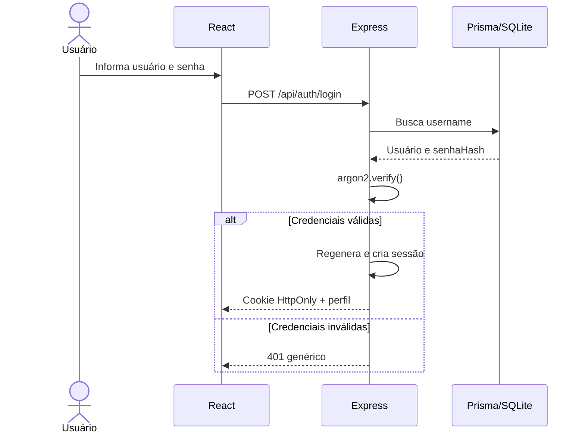

# Autenticação e autorização — CINCoders

**US-01:** Jira MAT-6  
**Estado:** Em implementação — o login HTTP e o fluxo de sessão ainda não foram comprovados por testes.  
**ADR relacionada:** `docs/adr/0003-autenticacao-por-sessao.md` (**Proposta**).

## Requisito

O sistema deve autenticar usuários por `username` e senha e diferenciar `ALUNO` de `SECRETARIA`. Usuários não autenticados não podem acessar rotas protegidas. Cada aluno só pode acessar seus próprios dados acadêmicos.

## Dados e credenciais

O modelo `Usuario` tem `id`, `username` único, `nome`, `senhaHash` e `perfil`. Quando o perfil é `ALUNO`, o registro `Aluno` relaciona esse usuário a um curso. O identificador acadêmico é um ID interno numérico, não o `username`.

- O seed cria `secretaria`, `aluno.si`, `aluno.cc`, `aluno.ec` e `aluno.si2`.
- A senha de desenvolvimento vem da variável local `SEED_PASSWORD` e não deve constar neste documento ou no Git.
- O seed usa `argon2.hash()` (Argon2id); o login usa `argon2.verify(hash, senha)`.
- `senhaHash` jamais deve ser enviado ao frontend.

## Fluxo proposto



O diagrama descreve o **comportamento pretendido**, não uma execução já verificada.

## Endpoints planejados

| Método | Endpoint | Entrada/saída resumida | Situação |
| --- | --- | --- | --- |
| `POST` | `/api/auth/login` | Recebe `{ username, senha }`; em sucesso, cria sessão e retorna `{ id, username, nome, perfil }` | Pendente |
| `GET` | `/api/auth/me` | Retorna identidade autenticada, ou `401` | Pendente |
| `POST` | `/api/auth/logout` | Destrói sessão e limpa cookie | Pendente |
| `GET` | `/api/health` | Verificação pública do servidor | Funciona, teste manual |

O contrato poderá ser refinado antes dos testes; não expor propriedades sensíveis. As respostas de erro não devem revelar se determinado usuário existe.

## Estrutura e responsabilidades

| Arquivo | Responsabilidade | Estado conhecido |
| --- | --- | --- |
| `src/config/database.ts` | Cria e exporta o Prisma Client com adaptador SQLite | Criado; sem erro reportado pelo editor |
| `src/modules/auth/auth.service.ts` | Busca `username`, verifica senha com Argon2id e retorna dados não sensíveis | Código implementado, testes pendentes |
| `src/config/session.ts` | Configura o cookie e o armazenamento de sessão | Configuração orientada; execução final não confirmada |
| `src/modules/auth/auth.controller.ts` | Validação HTTP, status e sessão | Pendente |
| `src/modules/auth/auth.routes.ts` | Rotas de login, identidade e logout | Pendente |
| `src/middlewares/auth.middleware.ts` | Exige autenticação e perfil autorizado | Pendente |

## Controles de segurança

1. **Hash:** comparar senhas com `argon2.verify`; não salvar nem registrar senhas em logs.
2. **Falha genérica:** retornar `401` para credenciais inválidas; não diferenciar usuário inexistente de senha errada.
3. **Sessão:** cookie `HttpOnly`, `SameSite=Lax` e `Secure` em HTTPS; configurar tempo limite e segredo por ambiente.
4. **Fixação de sessão:** regenerar identificador após login bem-sucedido.
5. **Logout:** destruir a sessão no armazenamento e limpar o cookie com opções compatíveis.
6. **Persistência:** `MemoryStore` de `express-session` é apenas provisório; definir armazenamento persistente antes da entrega.
7. **CSRF:** avaliar proteção de requisições mutáveis que usam cookies, além de `SameSite`.
8. **Autorização:** verificar perfil (`SECRETARIA`/`ALUNO`) em todas as rotas protegidas; recuperar o `alunoId` a partir da sessão e nunca confiar no ID fornecido pelo cliente para consultar dados privados.
9. **CORS:** permitir explicitamente a origem do frontend e credenciais; não usar `*` com cookies.
10. **Erros e observabilidade:** não expor stack traces, segredos nem hashes em respostas.

## Critérios Gherkin

```gherkin
Funcionalidade: Login e controle de acesso

  Cenário: Login válido
    Dado que existe um usuário com senha cadastrada
    Quando informa username e senha corretos
    Então a API cria uma sessão válida
    E retorna seu perfil sem senhaHash

  Cenário: Login inválido
    Quando informa credenciais incorretas
    Então a API responde com status 401
    E não informa qual credencial está incorreta

  Cenário: Usuário não autenticado
    Dado que não existe uma sessão válida
    Quando solicita uma rota protegida
    Então a API responde com status 401

  Cenário: Aluno tenta acessar registros de outro aluno
    Dado que um aluno está autenticado
    Quando solicita um registro acadêmico pertencente a outro aluno
    Então a API nega o acesso

  Cenário: Logout
    Dado que o usuário está autenticado
    Quando solicita o logout
    Então a sessão é invalidada
    E uma nova chamada a /api/auth/me retorna 401
```

## Testes previstos

- [ ] Login de secretaria com senha correta.
- [ ] Login de cada aluno com senha correta.
- [ ] Senha incorreta e usuário inexistente devolvem erro genérico.
- [ ] Respostas jamais contêm `senhaHash`.
- [ ] Cookie da sessão contém `HttpOnly` e atributos esperados.
- [ ] Login regenera sessão; logout revoga sessão e limpa cookie.
- [ ] `/me` sem cookie devolve `401`.
- [ ] Aluno não pode acessar rota da secretaria (`403`).
- [ ] Um aluno não pode consultar dados acadêmicos de outro aluno.

Executar testes automatizados com Vitest e Supertest. A especificação está pronta para implementação; os testes ainda não foram executados.

## Pendências para a entrega

- Definir e integrar armazenamento persistente de sessões.
- Implementar endpoints e middleware.
- Confirmar política de cookies no ambiente de execução final e proteção CSRF.
- Executar testes e registrar evidências na Sprint 1 e no Jira MAT-6.