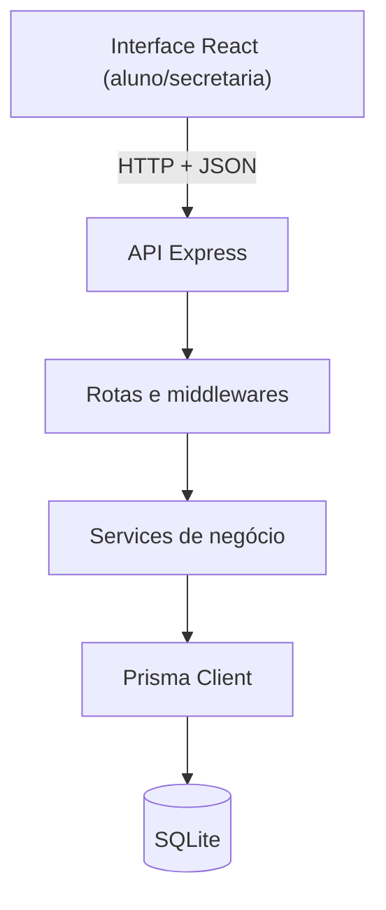

# Visão geral da arquitetura — CINCoders

> **Estado documental final — 23/11/2026:** US-01 a US-13 implementadas e validadas conforme os registros do responsável, incluindo o requisito adicional **US-13 — histórico de matrículas canceladas**. A navegação ganhou componentes compartilhados para aluno e secretaria, e o CSS recebeu ajustes de identidade visual e largura das listagens. A suíte completa da API passou com **133/133 testes em 11 arquivos** (28,94 s, banco `test.db`) e TypeScript aprovado; `DATABASE_URL` foi restaurada para `dev.db`. O frontend passou com **95/95 testes em 12 arquivos**, incluindo os casos do cliente HTTP, com lint e TypeScript aprovados. Total: **228 testes automatizados**, em duas suítes, e **48 verificações manuais** informadas como aprovadas (US-08 a US-13). O `schema.prisma` integral foi conferido com a modelagem física. O avaliador `selecaogersist` **aceitou o convite ao GitLab**, conforme Thiago; a publicação dos documentos finais é a próxima operação de Git.

## Evolução desde o checkpoint US-12 — requisito adicional e navegação

### US-13 — Histórico de matrículas canceladas (requisito à escolha)

- **Motivação:** dar ao aluno rastreabilidade dos cancelamentos realizados, sem misturar matrículas canceladas com as matrículas ativas. O registro permanece no banco mesmo após uma nova matrícula, de acordo com a decisão de rematrícula por novo registro (ADR-0001).
- **API:** `GET /api/aluno/matriculas/historico?pagina=1&limite=10`, protegida para `ALUNO`, consulta apenas matrículas com situação `CANCELADA` pertencentes ao aluno da **sessão**, com ordenação e metadados de paginação. Não aceitar uma identidade de aluno fornecida pelo cliente como critério de titularidade.
- **Frontend:** aba **Histórico de cancelamentos** na página `/aluno/matriculas`, implementada em `HistoricoMatriculas.tsx`. O componente é carregado ao selecionar a aba e apresenta registros cancelados, datas, estados de carregamento, vazio, erro/nova tentativa e paginação. A aba **Matrículas ativas** preserva consulta e cancelamento existentes.
- **Validação:** nove testes de `HistoricoMatriculas.test.tsx` aprovados no log do usuário; dez cenários API da US-13 incluídos no log integral **133/133 em 11 arquivos**; oito verificações manuais da US-13 aprovadas conforme relato do responsável. A nova tela de histórico constitui o requisito extra do enunciado e está explicada no **README revisado** com motivação e regras.

### Evolução da identidade visual e da navegação

- **Identidade em evolução:** azul-marinho, verde-petróleo/teal e fundo cinza-claro nos componentes e em `apps/web/src/index.css`. As referências visuais de **Classter** (secretaria) e **Aprova Total** (área do aluno) foram selecionadas apenas como inspiração para uma etapa posterior; não afirmar que o redesign completo já foi entregue.
- **Navegação administrativa:** componente compartilhado `SecretariaNav.tsx` com links para **Disciplinas**, **Professores** e **Turmas**. Corrigiu-se o problema relatado de a aba Turmas desaparecer ao acessar Disciplinas, e a estrutura não deve produzir links `<a>` aninhados.
- **Navegação do aluno:** `AlunoNav.tsx` reúne **Ofertas**, **Minhas matrículas** e **Progresso curricular** em todas as páginas, corrigindo a ausência de abas na tela de ofertas.
- **Layout administrativo:** estilos de listagem de largura ampliada para evitar tabelas confinadas em cartões estreitos. O responsável informou ter concluído as verificações manuais, inclusive **360px nas telas do aluno**.

### Checklist de fechamento técnico

- [x] `OfertasPage`, `MatriculasPage` e `ProgressoPage` oferecem nova tentativa após falha de comunicação, conforme testes automatizados e manuais.
- [x] Respostas `401` de chamadas protegidas são tratadas pelo cliente HTTP, com retorno ao login; reteste de sessão invalidada em outra aba aprovado.
- [x] Seed validado em banco novo com três cursos, disciplinas compartilhadas, secretaria e alunos com aprovações/reprovações.
- [x] Interface do aluno em 360px, URL de busca/paginação e estados de falha conferidos conforme relato.
- [x] README revisado; `schema.prisma` integral conferido com `docs/modelagem-fisica.md`.
- [x] Convite do GitLab aceito pelo avaliador `selecaogersist`, conforme confirmação do responsável.

**Publicação restante:** copiar os documentos para o repositório Windows e conferir o último commit/push. Os detalhes constam no [checklist de entrega](../entrega-checklist.md). Isso não corresponde a uma funcionalidade pendente.

---

## Checkpoint histórico — 22/11/2026 (após US-12)

**No encerramento da US-12**, a API Express/Prisma/SQLite e o frontend React/Vite cobriam autenticação, fluxo do aluno e administração de disciplinas (US-08/US-09), professores (US-10), consulta/abertura de turmas (US-11) e alteração de capacidade de turmas (US-12). As suítes completas passaram com **123 testes em 10 arquivos na API** (13,07 s) e **80 em 10 arquivos no frontend** (11,63 s): **203 testes automatizados em 20 arquivos, 0 falhas**, em execuções separadas. O responsável havia relatado **40 verificações manuais aprovadas** (8 por US-08 a US-12). Os números abaixo descrevem esse marco e não incluem a US-13.

## Situação funcional naquele checkpoint (22/11/2026)

| História | Entrega observada | Evidência automatizada | Limites / próximos cuidados |
| --- | --- | --- | --- |
| US-01 — Autenticação | Login, sessão, `/me`, logout e autorização por perfil na API | 11 testes backend (8 de autenticação + 3 de middleware) | CSRF, HTTPS/cookie `Secure` e persistência após reinício precisam de evidência específica |
| US-02 — Autenticação no React | Login, logout, contexto de autenticação e proteção de rotas | 11 testes frontend (4 + 3 + 4) | Validar navegação real e layout a 360px |
| US-03 — Consulta de ofertas | API e `OfertasPage` | 9 testes backend; arquivo `OfertasPage.test.tsx` com 5 cenários compartilhados com US-04 | Conferir uso real, paginação e responsividade |
| US-04 — Realização de matrícula | API transacional e ação no frontend de ofertas | 12 testes backend; parte dos 5 testes de `OfertasPage` | Testes de concorrência ampliados e fluxo ponta a ponta |
| US-05 — Matrículas ativas | API e `MatriculasPage` | 7 testes backend; 5 testes frontend | Validar navegação real e estados visuais |
| US-06 — Cancelamento | API e interface com confirmação | 10 testes backend; 4 testes frontend | Validar integração real e concorrência sob carga |
| US-07 — Progresso | API e `ProgressoPage` | 10 testes backend; 5 testes frontend | Validar apresentação, arredondamentos e responsividade |
| US-08 — Consulta de disciplinas (MAT-10) | `GET /api/secretaria/disciplinas`, busca, paginação e lista em `DisciplinasPage` sincronizada com URL | 8 testes backend; 6 frontend; 8 verificações manuais relatadas | Consulta implementada e validada; revisar acessibilidade/responsividade |
| US-09 — Cadastro e edição de disciplinas (MAT-13) | `POST` e `PATCH /api/secretaria/disciplinas/:id`; formulários de cadastro e edição | 17 testes backend (6 cadastro + 11 edição), 11 frontend (4 cadastro + 7 edição); 8 verificações manuais da edição | Funcionalidade implementada e validada; commit relatado como realizado, push/Jira a conferir. Exclusão não foi exigida nessa história |
| US-10 — Consulta e cadastro de professores (MAT-17) | `GET` e `POST /api/secretaria/professores`; listagem, busca por nome/e-mail, paginação e formulário React | 14 testes backend; 11 frontend (6 consulta + 5 cadastro); 8 verificações manuais relatadas | Funcionalmente validada e publicada no GitLab (`8425521`); Jira MAT-17 a conferir. A edição de professores não integra esta história |
| US-11 — Consulta e abertura de turmas | `GET` e `POST /api/secretaria/turmas`; pesquisa, paginação, capacidade e cadastro vinculando disciplina/professor | 15 testes backend; 14 frontend (6 consulta + 8 abertura); 8 verificações manuais relatadas | Funcionalmente validada; commit/push da US-11 confirmados pelo responsável, hash ainda a registrar |
| US-12 — Alteração de capacidade de turmas | `PATCH /api/secretaria/turmas/:id/vagas`; atualização condicional e transacional que respeita somente matrículas `ATIVA`; formulário de edição na `TurmasPage` | 10 testes backend; 8 frontend; 8 verificações manuais relatadas | Funcionalmente validada; documentação/commit/push da US-12 ainda em preparação |
| US-13 — Histórico de cancelamentos | `GET /api/aluno/matriculas/historico`, aba dedicada e preservação de registros `CANCELADA` | 10 cenários API incluídos no consolidado 133/133; 9 testes web com log; 8 manuais relatados | Requisito extra implementado; publicação final a confirmar |

**Atenção à contagem:** os testes da US-02 e de páginas do aluno são contabilizados apenas uma vez no total geral. Os 5 testes de `OfertasPage.test.tsx` atendem US-03/US-04 conjuntamente.

## Contratos HTTP em uso

| Método | Rota | Perfil permitido | Finalidade |
| --- | --- | --- | --- |
| `GET` | `/api/health` | Público | Estado básico da API |
| `POST` | `/api/auth/login` | Público | Iniciar sessão |
| `GET` | `/api/auth/me` | Autenticado | Identidade e perfil da sessão |
| `POST` | `/api/auth/logout` | Autenticado | Encerrar sessão |
| `GET` | `/api/aluno/ofertas` | `ALUNO` | Buscar e paginar turmas ofertadas |
| `POST` | `/api/aluno/matriculas` | `ALUNO` | Realizar matrícula |
| `GET` | `/api/aluno/matriculas` | `ALUNO` | Consultar matrículas ativas |
| `GET` | `/api/aluno/matriculas/historico` | `ALUNO` | Consultar histórico paginado de cancelamentos próprios (US-13) |
| `PATCH` | `/api/aluno/matriculas/:matriculaId/cancelar` | `ALUNO` | Cancelar matrícula própria |
| `GET` | `/api/aluno/progresso` | `ALUNO` | Consultar progresso curricular |
| `GET` | `/api/secretaria/disciplinas` | `SECRETARIA` | Listar, pesquisar e paginar disciplinas |
| `POST` | `/api/secretaria/disciplinas` | `SECRETARIA` | Cadastrar disciplina |
| `PATCH` | `/api/secretaria/disciplinas/:id` | `SECRETARIA` | Editar código, nome e/ou carga horária de disciplina |
| `GET` | `/api/secretaria/professores` | `SECRETARIA` | Listar, pesquisar e paginar professores |
| `POST` | `/api/secretaria/professores` | `SECRETARIA` | Cadastrar professor |
| `GET` | `/api/secretaria/turmas` | `SECRETARIA` | Consultar turmas, pesquisar, paginar e visualizar vagas ocupadas/disponíveis |
| `POST` | `/api/secretaria/turmas` | `SECRETARIA` | Abrir turma informando disciplina, professor e vagas totais |
| `PATCH` | `/api/secretaria/turmas/:id/vagas` | `SECRETARIA` | Ajustar vagas totais sem reduzir abaixo da quantidade de matrículas ativas |

As rotas React protegem a experiência de navegação, mas os middlewares e os services da API continuam responsáveis por autenticação, autorização e integridade dos dados.

## Contexto dos registros anteriores

As seções de 21/11/2026 abaixo foram mantidas para preservar a evolução do projeto. Quando mencionarem "frontend planejado", "frontend pendente" ou totais de 11, 39, 59 ou 70 testes, referem-se ao **checkpoint daquela data**, substituído pelo resumo atual acima.

> **Atualização histórica — 21/11/2026:** O frontend React já estava iniciado e o fluxo de login, logout e proteção de rotas havia sido implementado e testado. Descrições anteriores de frontend 'planejado' são checkpoints históricos.

## Frontend React — US-02 (MAT-7)

| Pasta (`apps/web/src`) | Responsabilidade |
| --- | --- |
| `api/` | Cliente HTTP e URL do backend |
| `components/` | Componentes reutilizáveis, inclusive logout |
| `contexts/` | Estado de autenticação e provedor |
| `hooks/` | Hook `useAuth` |
| `pages/` | Login e páginas acadêmicas |
| `routes/` | Navegação e proteção por perfil |
| `types/` | Contratos TypeScript do frontend |

Ao iniciar, o `AuthProvider` consulta `GET /api/auth/me`. O formulário envia credenciais para `POST /api/auth/login`; um login bem-sucedido direciona ALUNO a `/aluno/ofertas` e SECRETARIA a `/secretaria`. O logout chama `POST /api/auth/logout` e retorna a `/login`.

As requisições usam `credentials: "include"` para transportar o cookie de sessão `HttpOnly`. O frontend não armazena senha ou token no `localStorage`. A proteção de rotas React melhora a navegação, mas **a autorização de dados pertence à API**.

**Validação naquele checkpoint, em `apps/web`:** 11 testes aprovados (4 login, 3 logout, 4 rotas), `pnpm lint` e `pnpm exec tsc -b` sem erros. Backend: 59 testes em execução separada; total acumulado de 70. **Checkpoint atual: 203 testes (22/11/2026, após US-12).**

**Pendente:** interfaces acadêmicas definitivas, responsividade em 360px, revisão de CSRF e configuração de cookies HTTPS para produção.

**Estado do registro original:** documentação inicial de 21/11/2026. Para a situação atual de todo o sistema, consultar a seção **Situação funcional atual** acima.

## Objetivo e escopo

O CINCoders é uma aplicação de matrícula acadêmica com dois perfis: **aluno** e **secretaria**. O aluno consulta ofertas, realiza/cancela matrículas e acompanha o progresso curricular. A secretaria cadastra disciplinas e professores, abre turmas e ajusta vagas dentro das regras de negócio.

O objetivo do MVP é entregar primeiro o fluxo do aluno, os controles de acesso e os testes exigidos no enunciado. Consulte `docs/requisitos-e-backlog.md` para requisitos, Gherkin e prioridades detalhadas.

## Stack adotada

| Camada | Tecnologia | Situação |
| --- | --- | --- |
| Interface | React + TypeScript + Vite | Implementada nas telas de autenticação, aluno e consulta/cadastro de disciplinas |
| API HTTP | Express 5 + TypeScript, Node.js | API inicializada |
| Dados | Prisma ORM 7 + adaptador `better-sqlite3` | Implementada |
| Persistência | SQLite local | Banco criado e seed conferido |
| Senhas | Argon2id | Implementada e testada |
| Sessão | `express-session`, cookie HttpOnly | Implementada |
| Testes | Vitest, Supertest, Testing Library | 203 testes automatizados aprovados em 20 arquivos (22/11/2026) |
| Organização | Repositório GitLab + Jira MAT | Em uso |

## Componentes e fronteiras



- A interface é responsável pela apresentação, formulários e estados de carregamento/erro; não executa regras de autorização.

- As rotas e controllers fazem a tradução HTTP (validação de entrada, códigos de resposta e cookies).

- Os services aplicam as regras de matrícula e progresso e coordenam transações.

- O Prisma acessa o SQLite; componentes React não acessam o banco diretamente.

- A autenticação identifica o usuário; **autorização** confere perfil e propriedade dos dados a cada operação.

## Estrutura de pastas — snapshot inicial (21/11/2026)

```text

  apps/

    web/                         # React/Vite — indicação do plano original

    api/

      prisma/

        migrations/

        schema.prisma

        seed.ts

        verificar-seed.ts

      src/

        app.ts

        server.ts

        config/

          database.ts

          session.ts

        middlewares/

          auth.middleware.ts

        modules/

          auth/

            auth.service.ts

            auth.controller.ts

            auth.routes.ts

        types/

          express-session.d.ts

        generated/prisma/        # Gerado automaticamente

      tests/

        auth.test.ts

        auth.middleware.test.ts

  docs/

    adr/

    arquitetura/

    sprints/

    testes/

```

### Módulos acrescentados na implementação

O snapshot anterior foi conservado como registro do início do projeto. A estrutura utilizada nas suítes de 22/11/2026 também inclui:

```text
apps/api/src/modules/secretaria/
  disciplinas/
    disciplinas.service.ts
    disciplinas.controller.ts
    disciplinas.routes.ts
  professores/
    professores.service.ts
    professores.controller.ts
    professores.routes.ts
  turmas/
    turmas.service.ts
    turmas.controller.ts
    turmas.routes.ts
apps/api/tests/
  ofertas.test.ts
  matriculas.test.ts
  matriculas.consulta.test.ts
  matriculas.cancelamento.test.ts
  progresso.test.ts
  secretaria.disciplinas.test.ts
  secretaria.professores.test.ts
  secretaria.turmas.test.ts
apps/web/src/pages/
  aluno/OfertasPage.test.tsx
  aluno/MatriculasPage.test.tsx
  aluno/MatriculasCancelamento.test.tsx
  aluno/ProgressoPage.test.tsx
  secretaria/DisciplinasPage.tsx
  secretaria/DisciplinasPage.test.tsx
  secretaria/ProfessoresPage.tsx
  secretaria/ProfessoresPage.test.tsx
  secretaria/TurmasPage.tsx
  secretaria/TurmasPage.test.tsx
```

O cadastro da secretaria é registrado nas rotas de `apps/api/src/app.ts`. A árvore acima destaca as partes adicionadas; não pretende reproduzir todo o repositório.

## Modelo de dados

O schema físico contém nove entidades:

| Entidade | Papel |
| --- | --- |
| `Usuario` | Login, hash e perfil |
| `Aluno` | Identidade acadêmica com ID numérico e vínculo ao curso |
| `Curso` | Mínimos de carga horária para progresso |
| `Disciplina` | Código único e carga horária |
| `EstruturaCurricular` | Classificação da disciplina dentro de cada curso |
| `Professor` | Cadastro com e-mail único |
| `Turma` | Oferta, disciplina, professor e capacidade |
| `Matricula` | Matrícula ativa/cancelada e histórico de cancelamento |
| `Historico` | Aprovação/reprovação de disciplinas |

`EstruturaCurricular` contém `OBRIGATORIA` e `ELETIVA_PERFIL`; disciplina sem vínculo curricular naquele curso é tratada como **livre** pela regra de classificação, sem terceira categoria armazenada.

## Regras de domínio críticas

1. Disciplina tem código único e carga horária entre 15 e 120, múltipla de 15.

2. Professor tem e-mail único.

3. A turma tem ao menos uma vaga; redução de vagas não pode ficar abaixo das matrículas ativas.

4. Não pode haver matrícula em turma lotada ou em disciplina já aprovada pelo aluno.

5. Um aluno não pode possuir duas matrículas **ativas** em turmas de uma mesma disciplina, mesmo que sejam turmas distintas (ADR-0002).

6. Cancelar a matrícula mantém seu registro como `CANCELADA`; uma rematrícula elegível cria outro registro (ADR-0001).

7. Histórico com `APROVADA` integraliza carga horária; matrícula em andamento deve ser apresentada separadamente.

8. A API deve impedir acesso a registros de outro aluno.

Regras envolvendo quantidade de vagas e matrículas simultâneas precisam de verificação transacional. O schema validado **não comprova sozinho** essas invariantes.

## Dados de desenvolvimento

O seed possui três cursos (SI, CC, EC), quatro alunos e uma secretaria, com disciplinas compartilhadas classificadas de maneira diferente por curso. Há históricos aprovados e reprovados. Os usuários são fictícios e usam senha local definida por `SEED_PASSWORD`, armazenada com hash Argon2id.

## Configuração e operação

Execute os comandos abaixo em `apps/api`, com `.env` local configurado:

```powershell

  pnpm install

  pnpm exec prisma validate

  pnpm exec prisma migrate status

  pnpm exec prisma generate

  pnpm exec prisma db seed

  pnpm dev

```

O endpoint `GET /api/health` permite verificar se a API

está funcionando.

Durante o desenvolvimento, ele está disponível em:

http://localhost:3001/api/health

## Segurança e implantação

- Senhas armazenadas com hash Argon2id.

- Validação de credenciais no backend.

- Autenticação baseada em sessões.

- Cookies configurados com HttpOnly e SameSite=Lax.

- Middleware de autorização por perfil.

- Login, sessão, logout e autorização por perfil validados por **11 testes** de backend (8 de autenticação e 3 de middleware).

- Arquivos .env, bancos SQLite locais e dependências

não são versionados.

### Pendências de segurança

- Obter evidência de que uma sessão armazenada em SQLite permanece válida após reiniciar a API (o armazenamento persistente já foi integrado).

- Verificar atributos de segurança dos cookies em testes.

- Revisar proteção contra CSRF.

- Ampliar a verificação de isolamento de dados acadêmicos; as suítes de consulta de matrículas e progresso já exercitam casos de titularidade.

## Qualidade e testes

A API utiliza Vitest e Supertest para testes automatizados.

### Resultados históricos — início de 21/11/2026

| Módulo | Testes | Resultado |
|---|---:|---|
| Autenticação | 8 | Aprovados |
| Autorização por perfil | 3 | Aprovados |
| **Total** | **11** | **Aprovados** |

### Resultado consolidado — 22/11/2026

| Backend — arquivo | Testes aprovados |
| --- | ---: |
| `auth.test.ts` | 8 |
| `auth.middleware.test.ts` | 3 |
| `ofertas.test.ts` | 9 |
| `matriculas.test.ts` | 12 |
| `matriculas.consulta.test.ts` | 7 |
| `matriculas.cancelamento.test.ts` | 10 |
| `progresso.test.ts` | 10 |
| `secretaria.disciplinas.test.ts` | 25 (8 consulta + 6 cadastro + 11 edição) |
| `secretaria.professores.test.ts` | 14 (8 consulta + 6 cadastro/autorização/validação) |
| `secretaria.turmas.test.ts` | 25 (15 US-11 + 10 US-12: edição de capacidade) |
| **Total backend** | **123** |

| Frontend — arquivo | Testes aprovados |
| --- | ---: |
| `LoginPage.test.tsx` | 4 |
| `LogoutButton.test.tsx` | 3 |
| `AppRoutes.test.tsx` | 4 |
| `OfertasPage.test.tsx` | 5 |
| `MatriculasPage.test.tsx` | 5 |
| `MatriculasCancelamento.test.tsx` | 4 |
| `ProgressoPage.test.tsx` | 5 |
| `DisciplinasPage.test.tsx` | 17 (6 consulta + 4 cadastro + 7 edição) |
| `ProfessoresPage.test.tsx` | 11 (6 consulta + 5 cadastro) |
| `TurmasPage.test.tsx` | 22 (14 US-11 + 8 US-12: edição de capacidade) |
| **Total frontend** | **80** |

**Total geral: 203/203 testes aprovados, 20 arquivos e 0 falhas.** As execuções completas de `pnpm exec vitest run` foram feitas separadamente para `apps/api` e `apps/web`: o backend (**123/123**, 13,07 s) e o frontend (**80/80**, 11,63 s) tiveram logs compartilhados. Os testes focados da US-12 também passaram (25/25 no arquivo API de turmas, dos quais 10 pertencem à US-12; 22/22 no arquivo frontend de turmas, dos quais 8 pertencem à US-12), mas **não são somados novamente**. `pnpm lint` e `pnpm exec tsc -b` passaram no frontend, e `pnpm exec tsc --noEmit` foi confirmado para a API. Foram relatadas **40 verificações manuais aprovadas** (8 por história entre US-08 e US-12), distintas dos testes automatizados. O aviso de links HTML aninhados do checkpoint da US-11 foi corrigido anteriormente.

A aplicação utiliza bancos SQLite separados para

dados acadêmicos e armazenamento de sessões.

As sessões de desenvolvimento e testes também

são armazenadas em arquivos distintos.

A descrição detalhada dos testes está disponível em

`docs/testes/plano-de-testes.md`.

## Consulta de ofertas — US-03

**Endpoint:** `GET /api/aluno/ofertas`

**Autorização:** Perfil `ALUNO`.

### Parâmetros

- `busca`: pesquisa por nome ou código da disciplina.

- `pagina`: página solicitada; padrão 1.

- `limite`: quantidade de ofertas; padrão 10, máximo 50.

### Informações retornadas

- Disciplina e professor.

- Vagas totais, ocupadas e disponíveis.

- Classificação curricular relativa ao curso do aluno.

- Metadados de paginação.

A API utiliza o usuário autenticado para identificar

o curso do aluno. O cliente não informa o `alunoId`.

**Status em 22/11/2026:** backend implementado (9 testes) e `OfertasPage` implementada/testada no frontend. A verificação visual a 360px e a integração ponta a ponta ainda precisam de evidência formal.

### Realização de matrícula — US-04

**Jira:** MAT-11

**Endpoint:** `POST /api/aluno/matriculas`

**Autorização:** perfil `ALUNO`.

**Entrada:** `{ "turmaId": 3 }`

O identificador acadêmico do aluno é recuperado a partir

da sessão autenticada. O cliente não informa `alunoId`.

#### Regras de negócio implementadas

1. A turma solicitada deve existir.

2. A turma deve possuir vagas disponíveis.

3. O aluno não pode ter sido aprovado anteriormente na disciplina.

4. O aluno não pode possuir matrícula ativa em outra turma da mesma disciplina.

5. A reprovação anterior não impede uma nova tentativa.

6. A rematrícula após cancelamento cria um novo registro.

7. As verificações e a criação da matrícula são executadas em transação.

As regras de rematrícula e unicidade de matrícula ativa

seguem, respectivamente, as ADRs 0001 e 0002.

#### Respostas HTTP

| Código | Significado |
|---|---|
| 201 | Matrícula realizada |
| 400 | Identificador de turma inválido |
| 401 | Usuário não autenticado |
| 403 | Perfil não autorizado ou cadastro acadêmico ausente |
| 404 | Turma inexistente |
| 409 | Violação de regra de matrícula |

#### Testes automatizados

**Arquivo:** `apps/api/tests/matriculas.test.ts`

**Resultado:** 12 testes aprovados em 21/11/2026.

A suíte valida matrícula válida, autenticação, autorização,

turma inexistente, entradas inválidas, aprovação anterior,

matrícula duplicada, turma lotada, rematrícula, reprovação

e atualização das vagas.

Também foi realizado um teste com dois alunos disputando

simultaneamente a última vaga. Nessa execução, apenas

uma matrícula foi confirmada.

#### Limitações atuais

- **Nota histórica (21/11):** a interface React ainda não havia sido implementada; em 22/11 o fluxo de ofertas/matrícula já aparece nas suítes frontend.

- O cancelamento via API pertence à US-06 e já foi implementado em seu próprio endpoint; o teste original CT-09 da US-04 continua simulando cancelamento diretamente no banco.

- A persistência da matrícula foi validada no banco de testes.

- Testes adicionais de concorrência e carga permanecem recomendados.

**Status em 22/11/2026:** backend implementado e validado; fluxo de matrícula presente no frontend. Ainda não há evidência de teste ponta a ponta completo.

### Consulta de matrículas ativas — US-05

**Jira:** MAT-8

**Endpoint:** `GET /api/aluno/matriculas`

**Autorização:** perfil `ALUNO`.

A API identifica o aluno pela sessão autenticada e

retorna somente suas matrículas com situação `ATIVA`.

Cada registro apresenta:

- Identificador da matrícula e da turma.

- Data da matrícula.

- Código, nome e carga horária da disciplina.

- Identificador e nome do professor.

O cliente não escolhe o `alunoId`.

**Validação:** 7 testes automatizados aprovados.

**Status em 22/11/2026:** backend implementado e testado (7 casos); `MatriculasPage` implementada e testada (5 casos frontend).

### Cancelamento de matrícula — US-06

**Jira:** MAT-15

**Endpoint:** `PATCH /api/aluno/matriculas/:matriculaId/cancelar`

**Autorização:** perfil `ALUNO`.

O aluno só pode cancelar suas próprias matrículas ativas.

O cancelamento:

- Altera a situação para `CANCELADA`.

- Registra a data em `canceladaEm`.

- Preserva o registro original.

- Libera a vaga automaticamente.

- Permite rematrícula elegível mediante novo registro.

A atualização utiliza condições de titularidade e situação

ativa na própria operação do banco.

**Validação:** 10 testes automatizados aprovados.

**Status em 22/11/2026:** backend implementado e testado (10 casos); interface de confirmação de cancelamento testada (4 casos frontend).

### Progresso curricular — US-07

**Jira:** MAT-12

**Endpoint:** `GET /api/aluno/progresso`

**Autorização:** perfil `ALUNO`.

O progresso é calculado conforme o curso do aluno autenticado.

O sistema apresenta:

- CH exigida por categoria.

- CH integralizada por aprovação.

- CH em curso, separadamente.

- CH faltante.

- Percentual de conclusão.

- Resumo total do progresso.

**Regras:**

- Apenas históricos aprovados integralizam CH.

- Reprovações não integralizam CH.

- Matrículas ativas representam CH em curso.

- O excedente aprovado de perfil conta como livre.

- Percentuais são limitados a 100%.

- CH faltante nunca é negativa.

- Aprovações duplicadas não são somadas duas vezes.

**Validação:** 10 testes automatizados aprovados.

**Status em 22/11/2026:** backend implementado e testado (10 casos); `ProgressoPage` implementada e testada (5 casos frontend).

## Consulta de disciplinas pela secretaria — US-08 (MAT-10)

**Endpoint:** `GET /api/secretaria/disciplinas` (somente `SECRETARIA`, com `401` sem sessão e `403` para aluno).

| Parâmetro | Funcionamento |
| --- | --- |
| `busca` | Pesquisa textual por código ou nome; omitir para consultar todas as disciplinas |
| `pagina` | Página da listagem, iniciando em 1 |
| `limite` | Registros por página; padrão 10 e máximo 50 |

Parâmetros de paginação inválidos são rejeitados com `400`. A API pesquisa e conta registros no banco, ordena por código e ID e aplica `skip`/`take` antes de retornar os dados. A resposta inclui `disciplinas` (lista) e `paginacao` com `pagina`, `limite`, `total` e `totalPaginas`.

A `DisciplinasPage` inclui tabela, formulário de busca, navegação de páginas e estados de carregamento, resultado vazio e erro com opção de tentar novamente. Busca e página ficam refletidas na URL, de modo que a consulta possa ser reproduzida pelo histórico/navegação. Após criar uma disciplina, a listagem é consultada novamente. As verificações manuais do responsável foram **8/8 aprovadas**, abrangendo listagem, pesquisa, parâmetros da URL, resultado vazio, atualização após cadastro, paginação e recuperação de erro.

**Evidência:** 8 testes de integração da API e 6 testes de componente de consulta, todos aprovados. A validação manual foi relatada pelo responsável; não há gravação de teste E2E automatizado associada a esse resultado.

## Cadastro e edição de disciplinas pela secretaria — US-09 (MAT-13)

**Endpoints:** `POST /api/secretaria/disciplinas` (cadastro) e `PATCH /api/secretaria/disciplinas/:id` (edição parcial).

**Autorização:** usuário autenticado com perfil `SECRETARIA`, utilizando middleware de perfil na API. Uma sessão ausente recebe `401`; um aluno autenticado não tem autorização (`403`). A proteção da rota React `/secretaria` é adicional, e não substitui a verificação na API.

### Contrato de entrada

```json
{
  "codigo": "IF100",
  "nome": "Introdução à Computação",
  "cargaHoraria": 60
}
```

O exemplo demonstra o formato dos dados, sem representar necessariamente uma disciplina do seed.

| Campo | Regras de cadastro |
| --- | --- |
| `codigo` | String obrigatória; código normalizado com remoção de espaços nas extremidades e conversão para maiúsculas; unicidade no banco |
| `nome` | String obrigatória; espaços excedentes nas extremidades não fazem parte do nome útil |
| `cargaHoraria` | Número inteiro entre 15 e 120, inclusivos, e múltiplo de 15 |

Na **edição**, o `id` deve ser inteiro positivo e seguro. O corpo deve conter ao menos um dos campos `codigo`, `nome` ou `cargaHoraria`; cada campo informado segue as mesmas regras de valor do cadastro. Código e nome são normalizados pelo service. Por exemplo, `PATCH /api/secretaria/disciplinas/3` com `{ "nome": "Engenharia de Software" }` modifica apenas o nome.

### Respostas HTTP esperadas

| Status | Interpretação |
| --- | --- |
| `201 Created` | Disciplina criada |
| `400 Bad Request` | Dados obrigatórios ausentes ou inválidos, incluindo carga horária fora da regra |
| `401 Unauthorized` | Não autenticado |
| `403 Forbidden` | Usuário sem perfil de secretaria |
| `409 Conflict` | Código de disciplina já existente |

No `PATCH`, o sucesso retorna `200 OK` com a disciplina atualizada. O código `404 Not Found` identifica disciplina inexistente; `400` também cobre ID inválido, corpo vazio ou dados fora das regras. O service usa `prisma.disciplina.update` e trata os erros do Prisma `P2002` (unicidade) e `P2025` (registro não localizado). O banco impede duplicidade inclusive em requisições concorrentes; atualizar a disciplina mantendo seu próprio código é permitido.

### Separação de responsabilidades

- `disciplinas.routes.ts`: declara `GET`, `POST` e `PATCH /:id` com autorização de `SECRETARIA`.
- `disciplinas.controller.ts`: valida dados e identificador, restringe campos editáveis e converte resultados/erros em respostas HTTP.
- `disciplinas.service.ts`: normaliza código/nome, executa operações no Prisma e interpreta erros de unicidade e registro inexistente.
- `apps/web/src/pages/secretaria/DisciplinasPage.tsx`: mantém listagem, busca/paginação e cadastro; acrescenta ação **Editar** por linha, formulário preenchido com valores atuais, **Salvar alterações**/**Cancelar edição**, validação, estados de envio/erro/sucesso e recarregamento da listagem sem apagar os parâmetros de busca/página na URL.
- `apps/web/src/routes/AppRoutes.tsx`: vincula a área da secretaria às regras de navegação do frontend.

### Evidências e limites

- **API:** `apps/api/tests/secretaria.disciplinas.test.ts`, 6 testes de cadastro e 11 de edição aprovados. A edição cobre atualização integral/parcial, autorização, ID inválido, inexistência, duplicidade, CH inválida, corpo sem alterações e manutenção do próprio código.
- **Frontend:** `apps/web/src/pages/secretaria/DisciplinasPage.test.tsx`, 4 testes de cadastro e 7 de edição aprovados. Os novos testes cobrem formulário preenchido, cancelamento, `PATCH`/atualização da lista e da URL, duplicidade, CH inválida, envio pendente e nova tentativa após falha.
- **Manual:** o responsável informou **8/8 verificações da edição aprovadas**, incluindo cancelamento, persistência após recarregar, erro de código duplicado, carga horária inválida e preservação da busca; somam-se às 8/8 verificações da consulta (US-08).
- **Escopo naquele checkpoint:** US-09 funcionalmente concluída e validada. O responsável confirmou o versionamento da etapa; o cadastro de professores, a abertura/ajuste de turmas e o requisito adicional foram concluídos **posteriormente** nas US-10 a US-13. Testes de componente e manuais não substituem automaticamente uma suíte E2E reproduzível.

## Consulta e cadastro de professores pela secretaria — US-10 (MAT-17)

**Endpoints:** `GET /api/secretaria/professores` para consulta e `POST /api/secretaria/professores` para cadastro, ambos protegidos por `exigirPerfil("SECRETARIA")`. Sem autenticação, a API responde `401`; aluno autenticado recebe `403`.

### Modelo e contratos

O modelo Prisma `Professor` possui `id` autoincremental, `nome`, `email` único e vínculo `turmas` para futuras operações de abertura de turmas. **Não foi necessária migração**, pois a entidade já constava do schema.

| Operação | Entrada | Resultado | Comportamento |
| --- | --- | --- | --- |
| `GET /api/secretaria/professores` | `busca` opcional, `pagina` (padrão 1), `limite` (padrão 10, máximo 50) | `200` com `professores` e `paginacao` | Busca por nome ou e-mail, ordenação estável por nome/ID e paginação no banco |
| `POST /api/secretaria/professores` | `{ "nome": "Ana Silva", "email": "ana@example.com" }` | `201` com professor criado | Nome obrigatório; e-mail válido, normalizado em minúsculas, único no banco |

Na consulta, `paginacao` apresenta `pagina`, `limite`, `total` e `totalPaginas`. Parâmetros inválidos retornam `400`, assim como dados inválidos no cadastro. O `POST` retorna `409` para e-mail já cadastrado, reconhecendo o erro de unicidade `P2002` do Prisma; falhas internas são tratadas com `500` sem expor detalhes do banco.

### Responsabilidades e interface

- `apps/api/src/modules/secretaria/professores/professores.routes.ts`: define GET/POST com controle de acesso por perfil.
- `professores.controller.ts`: valida entrada e parâmetros de consulta, mapeia os resultados do service para respostas HTTP.
- `professores.service.ts`: normaliza nome/e-mail, persiste no Prisma, trata unicidade e consulta com `count` + `findMany` em transação de leitura, filtros e `skip`/`take`.
- `apps/web/src/pages/secretaria/ProfessoresPage.tsx`: apresenta tabela, busca sincronizada com a URL, paginação, carregamento, lista vazia, erro com nova tentativa e formulário de cadastro com bloqueio de reenvio, feedback de sucesso/erro e atualização da lista.
- `apps/web/src/routes/AppRoutes.tsx`: protege `/secretaria/professores` para o perfil `SECRETARIA`; a navegação administrativa também passou a incluir **Turmas** na US-11. A proteção visual não substitui o middleware da API.

### Evidências e limites

- **Backend:** `apps/api/tests/secretaria.professores.test.ts`, **14/14 testes aprovados**, cobrindo acesso sem sessão/aluno, listagem, pesquisa por nome/e-mail, paginação, parâmetros inválidos, lista vazia, cadastro persistido, e-mail duplicado e entradas inválidas.
- **Frontend:** `apps/web/src/pages/secretaria/ProfessoresPage.test.tsx`, **11/11 testes aprovados** (5 de cadastro e 6 de consulta). Confirmam campos, envio, erro de duplicidade, validação de e-mail, bloqueio de envio, resultados, URL, paginação, vazio, falha/nova tentativa e carregamento.
- **Manual:** **8/8 verificações aprovadas**, conforme confirmação do responsável, após integração da página à navegação. A execução manual não equivale a uma suíte E2E automatizada reproduzível.
- **Escopo naquele marco:** US-10 funcionalmente implementada, validada e publicada no GitLab (`8425521`). Conferir Jira MAT-17. Depois foram concluídas funcionalmente as US-11 e US-12; permanecem o requisito adicional, a revisão de segurança e os testes de responsividade.

## Consulta e abertura de turmas pela secretaria — US-11

**Endpoints:** `GET /api/secretaria/turmas` (listagem) e `POST /api/secretaria/turmas` (abertura), ambos protegidos por `exigirPerfil("SECRETARIA")` e montados em `apps/api/src/app.ts`. Sessão ausente retorna `401`; aluno autenticado recebe `403`.

### Modelo e contratos HTTP

O modelo `Turma` já existia no schema Prisma, com `id`, `disciplinaId`, `professorId`, `vagasTotais` e as relações `disciplina`, `professor` e `matriculas`. **Nenhuma migração foi necessária para a US-11.** Não se impôs unicidade artificial ao par disciplina/professor: abrir turmas distintas para a mesma combinação é permitido pelo modelo atual.

| Operação | Entrada | Saída e regras |
| --- | --- | --- |
| `GET /api/secretaria/turmas` | `busca` opcional (código/nome da disciplina ou nome do professor), `pagina` padrão 1, `limite` padrão 10 e máximo 50 | `200` com `turmas` e `paginacao`; pesquisa no banco, ordenação estável por `id`, parâmetros inválidos `400` |
| `POST /api/secretaria/turmas` | `{ "disciplinaId": 1, "professorId": 1, "vagasTotais": 30 }` | `201` com turma aberta; `400` para identificadores/quantidade inválidos; `404` para disciplina ou professor inexistentes |

Na listagem, cada turma retorna seus identificadores, os dados da disciplina e do professor, `vagasTotais`, `vagasOcupadas` e `vagasDisponiveis`. **Somente matrículas `ATIVA` ocupam vagas; as `CANCELADA` não entram na contagem.** A API utiliza `_count` filtrado do Prisma e calcula `vagasDisponiveis` sem valor negativo. A resposta inclui `paginacao: { pagina, limite, total, totalPaginas }`. A criação valida números inteiros positivos dentro do intervalo do `Int` do Prisma; o service confirma a existência das referências e trata também erro de integridade referencial `P2003`.

### Responsabilidades e experiência React

- `apps/api/src/modules/secretaria/turmas/turmas.routes.ts`: declara GET/POST com autorização de secretaria.
- `turmas.controller.ts`: valida query/body, converte resultados em `200`, `201`, `400`, `404` e `500` e evita expor erros internos nas respostas.
- `turmas.service.ts`: executa buscas, `count` + `findMany` com ordenação e paginação, contagem de matrículas ativas e `create` com relações válidas.
- `apps/web/src/pages/secretaria/TurmasPage.tsx`: exibe disciplina, professor, vagas ocupadas/totais e disponíveis; integra busca/URL, paginação, estados de carregamento, vazio e erro/nova tentativa; permite abertura de turma com campos obrigatórios, feedback e recarga da lista após cadastro.
- O formulário pesquisa opções de disciplinas e professores com suas rotas GET existentes (`limite=50` por consulta), permitindo encontrar opções além da primeira página sem depender de IDs digitados manualmente.
- `apps/web/src/routes/AppRoutes.tsx`: protege `/secretaria/turmas`; navegação administrativa com **Disciplinas · Professores · Turmas**. Durante a implementação, um aviso de `<a>` aninhado foi corrigido antes da validação final.

### Evidência e limites

- **Backend:** `apps/api/tests/secretaria.turmas.test.ts` — **15/15 testes aprovados**. Inclui acesso, pesquisa por disciplina/professor, paginação estável, parâmetros inválidos, lista vazia, criação persistida, IDs/vagas inválidos, referências inexistentes e **exclusão das matrículas canceladas do total ocupado**.
- **Frontend:** `apps/web/src/pages/secretaria/TurmasPage.test.tsx` — **14/14 testes aprovados**: 6 de consulta e 8 de abertura. Abrange URL, navegação, carregamento, erro/nova tentativa, validação, salvamento, prevenção de envio duplicado e busca das opções do formulário.
- **Manual:** o responsável confirmou as **8 verificações manuais como funcionando**, incluindo consulta, busca, abertura válida, persistência e navegação; a paginação entre páginas depende da existência de registros suficientes para exercê-la. As verificações manuais não constituem evidência de E2E automatizada.
- **Estado:** **US-11 funcionalmente implementada e validada**; seu commit/push foi confirmado pelo responsável após este checkpoint, sem hash fornecido. A **US-12 — ajuste de capacidade** foi implementada posteriormente e está descrita na seção seguinte. Requisito adicional, avaliação a 360px e revisões de segurança continuam no plano de entrega.

## Alteração da capacidade de turmas pela secretaria — US-12

**Endpoint:** `PATCH /api/secretaria/turmas/:id/vagas`, declarado em `turmas.routes.ts` com `exigirPerfil("SECRETARIA")`. Mantém o identificador da turma, disciplina e professor; altera exclusivamente `vagasTotais`. Não foi necessária migração, pois o campo já existe no modelo Prisma `Turma`.

### Contrato HTTP e integridade da capacidade

| Situação | Resposta | Efeito no banco |
| --- | --- | --- |
| Secretaria altera `vagasTotais` para inteiro positivo válido, maior ou igual às matrículas ativas | `200` com mensagem e turma atualizada | Persiste a capacidade e recalcula vagas ocupadas/disponíveis |
| `id` ou `vagasTotais` inválido, decimal, zero, negativo ou fora do intervalo `Int` | `400` | Nenhuma alteração |
| Identificador de turma válido, mas inexistente | `404` | Nenhuma alteração |
| Capacidade solicitada inferior ao número de matrículas `ATIVA` | `409` com `vagasOcupadas` | Nenhuma alteração |
| Sem sessão ou com perfil `ALUNO` | `401` ou `403` | Nenhuma alteração |

**Operação atômica:** `alterarCapacidadeTurma` usa uma transação Prisma contendo um `UPDATE` SQL parametrizado. A própria condição `WHERE` exige que `vagasTotais` solicitado seja maior ou igual à contagem de matrículas `ATIVA` da turma; uma matrícula `CANCELADA` não entra nessa contagem. Essa condição é avaliada no mesmo comando que persiste a alteração, evitando a janela entre uma consulta isolada e um `update` posterior. O retorno busca os vínculos, utiliza `_count` filtrado e calcula `vagasDisponiveis = vagasTotais - vagasOcupadas`. Não equivale a um teste de estresse concorrente com matrícula simultânea, que ainda pode ser ampliado.

### Interface React e validação

- `TurmasPage.tsx` adiciona **Editar vagas** em cada linha, formulário preenchido com a capacidade atual, contagem das vagas ocupadas e botões **Salvar capacidade** e **Cancelar edição**.
- O campo numérico exige inteiro positivo até `2_147_483_647` e limita a redução com base na ocupação exibida. A API permanece responsável pela validação definitiva, inclusive quando a ocupação muda durante a edição.
- Durante a requisição, a edição não pode ser reenviada nem cancelada; falhas preservam o formulário para nova tentativa. Um `409` apresenta mensagem de conflito.
- Após sucesso, a tabela é recarregada por `versaoLista`, sem modificar `busca` ou `pagina` da URL; a mensagem de confirmação informa a nova capacidade.

### Evidências de conclusão da US-12

- **Backend:** 10 novos testes em `secretaria.turmas.test.ts` (CT-01 a CT-10), cobrindo autenticação, autorização, aumento, redução permitida, capacidade igual à ocupação, recusa de redução inferior, valores/IDs inválidos, inexistência e consulta após atualização. **25/25 no arquivo de turmas** (4,86 s) e **123/123 na API completa** (13,07 s).
- **Frontend:** 8 novos testes em `TurmasPage.test.tsx`, cobrindo pré-preenchimento, cancelamento sem PATCH, sucesso e recarga preservando URL, validação local, conflito, bloqueio de reenvio, recuperação após erro e seleção correta da linha. **22/22 no arquivo** (7,55 s) e **80/80 no frontend completo** (11,63 s); ESLint e TypeScript aprovados.
- **Manual:** o responsável informou que concluiu as **8 verificações propostas da US-12**. Este registro é baseado no relato, não em captura independente nem em suíte E2E automatizada.
- **Situação:** **US-12 implementada e funcionalmente validada**; documentação atualizada nesta etapa, commit/push e chave Jira ainda a conferir. Permanecem o requisito adicional, revisão de segurança, responsividade e conferência final da entrega.

## Referências internas

- `docs/requisitos-e-backlog.md`

- `docs/modelagem-fisica.md`

- `docs/adr/0001-rematricula-novo-registro.md`

- `docs/adr/0002-unicidade-matricula-ativa-por-disciplina.md`

- `docs/adr/0003-autenticacao-por-sessao.md`

- `docs/sprints/sprint-0.md` e `docs/sprints/sprint-1.md`