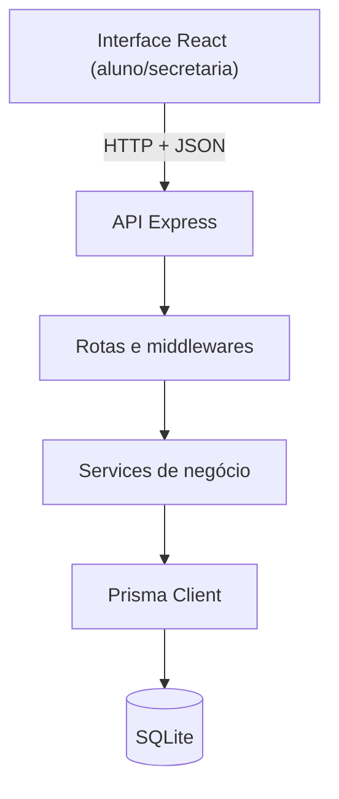

# Visão geral da arquitetura — CINCoders

> **Estado atualizado — 22/11/2026:** API Express/Prisma/SQLite e frontend React/Vite implementados para autenticação, ofertas, matrícula, consulta, cancelamento, progresso e disciplinas da secretaria. A consulta/pesquisa/paginação (US-08) e o cadastro **e edição** (US-09) de disciplinas estão implementados. As suítes completas registraram **84 testes aprovados em 8 arquivos no backend** (resultado confirmado pelo responsável) e **47 em 8 arquivos no frontend** (log apresentado): **131 testes, 16 arquivos, 0 falhas**, em execuções separadas. O responsável relatou **8 verificações manuais da US-08 e 8 da US-09 aprovadas**. Isso não comprova, isoladamente, segurança de produção ou encerramento do MVP completo.

## Situação funcional atual

| História | Entrega observada | Evidência automatizada | Limites / próximos cuidados |
| --- | --- | --- | --- |
| US-01 — Autenticação | Login, sessão, `/me`, logout e autorização por perfil na API | 11 testes backend (8 de autenticação + 3 de middleware) | CSRF, HTTPS/cookie `Secure` e persistência após reinício precisam de evidência específica |
| US-02 — Autenticação no React | Login, logout, contexto de autenticação e proteção de rotas | 11 testes frontend (4 + 3 + 4) | Validar navegação real e layout a 360px |
| US-03 — Consulta de ofertas | API e `OfertasPage` | 9 testes backend; arquivo `OfertasPage.test.tsx` com 5 cenários compartilhados com US-04 | Conferir uso real, paginação e responsividade |
| US-04 — Realização de matrícula | API transacional e ação no frontend de ofertas | 12 testes backend; parte dos 5 testes de `OfertasPage` | Testes de concorrência ampliados e fluxo ponta a ponta |
| US-05 — Matrículas ativas | API e `MatriculasPage` | 7 testes backend; 5 testes frontend | Validar navegação real e estados visuais |
| US-06 — Cancelamento | API e interface com confirmação | 10 testes backend; 4 testes frontend | Validar integração real e concorrência sob carga |
| US-07 — Progresso | API e `ProgressoPage` | 10 testes backend; 5 testes frontend | Validar apresentação, arredondamentos e responsividade |
| US-08 — Consulta de disciplinas (MAT-10) | `GET /api/secretaria/disciplinas`, busca, paginação e lista em `DisciplinasPage` sincronizada com URL | 8 testes backend; 6 frontend; 8 verificações manuais relatadas | Consulta implementada e validada; revisar acessibilidade/responsividade |
| US-09 — Cadastro e edição de disciplinas (MAT-13) | `POST` e `PATCH /api/secretaria/disciplinas/:id`; formulários de cadastro e edição | 17 testes backend (6 cadastro + 11 edição), 11 frontend (4 cadastro + 7 edição); 8 verificações manuais da edição | Funcionalidade implementada e validada; commit da edição e atualização Jira pendentes. Exclusão não foi exigida nessa história |

**Atenção à contagem:** os testes da US-02 e de páginas do aluno são contabilizados apenas uma vez no total geral. Os 5 testes de `OfertasPage.test.tsx` atendem US-03/US-04 conjuntamente.

## Contratos HTTP em uso

| Método | Rota | Perfil permitido | Finalidade |
| --- | --- | --- | --- |
| `GET` | `/api/health` | Público | Estado básico da API |
| `POST` | `/api/auth/login` | Público | Iniciar sessão |
| `GET` | `/api/auth/me` | Autenticado | Identidade e perfil da sessão |
| `POST` | `/api/auth/logout` | Autenticado | Encerrar sessão |
| `GET` | `/api/aluno/ofertas` | `ALUNO` | Buscar e paginar turmas ofertadas |
| `POST` | `/api/aluno/matriculas` | `ALUNO` | Realizar matrícula |
| `GET` | `/api/aluno/matriculas` | `ALUNO` | Consultar matrículas ativas |
| `PATCH` | `/api/aluno/matriculas/:matriculaId/cancelar` | `ALUNO` | Cancelar matrícula própria |
| `GET` | `/api/aluno/progresso` | `ALUNO` | Consultar progresso curricular |
| `GET` | `/api/secretaria/disciplinas` | `SECRETARIA` | Listar, pesquisar e paginar disciplinas |
| `POST` | `/api/secretaria/disciplinas` | `SECRETARIA` | Cadastrar disciplina |
| `PATCH` | `/api/secretaria/disciplinas/:id` | `SECRETARIA` | Editar código, nome e/ou carga horária de disciplina |

As rotas React protegem a experiência de navegação, mas os middlewares e os services da API continuam responsáveis por autenticação, autorização e integridade dos dados.

## Contexto dos registros anteriores

As seções de 21/11/2026 abaixo foram mantidas para preservar a evolução do projeto. Quando mencionarem "frontend planejado", "frontend pendente" ou totais de 11, 39, 59 ou 70 testes, referem-se ao **checkpoint daquela data**, substituído pelo resumo atual acima.

> **Atualização histórica — 21/11/2026:** O frontend React já estava iniciado e o fluxo de login, logout e proteção de rotas havia sido implementado e testado. Descrições anteriores de frontend 'planejado' são checkpoints históricos.

## Frontend React — US-02 (MAT-7)

| Pasta (`apps/web/src`) | Responsabilidade |
| --- | --- |
| `api/` | Cliente HTTP e URL do backend |
| `components/` | Componentes reutilizáveis, inclusive logout |
| `contexts/` | Estado de autenticação e provedor |
| `hooks/` | Hook `useAuth` |
| `pages/` | Login e páginas acadêmicas |
| `routes/` | Navegação e proteção por perfil |
| `types/` | Contratos TypeScript do frontend |

Ao iniciar, o `AuthProvider` consulta `GET /api/auth/me`. O formulário envia credenciais para `POST /api/auth/login`; um login bem-sucedido direciona ALUNO a `/aluno/ofertas` e SECRETARIA a `/secretaria`. O logout chama `POST /api/auth/logout` e retorna a `/login`.

As requisições usam `credentials: "include"` para transportar o cookie de sessão `HttpOnly`. O frontend não armazena senha ou token no `localStorage`. A proteção de rotas React melhora a navegação, mas **a autorização de dados pertence à API**.

**Validação naquele checkpoint, em `apps/web`:** 11 testes aprovados (4 login, 3 logout, 4 rotas), `pnpm lint` e `pnpm exec tsc -b` sem erros. Backend: 59 testes em execução separada; total acumulado de 70. **Checkpoint atual: 131 testes (22/11/2026).**

**Pendente:** interfaces acadêmicas definitivas, responsividade em 360px, revisão de CSRF e configuração de cookies HTTPS para produção.

**Estado do registro original:** documentação inicial de 21/11/2026. Para a situação atual de todo o sistema, consultar a seção **Situação funcional atual** acima.

## Objetivo e escopo

O CINCoders é uma aplicação de matrícula acadêmica com dois perfis: **aluno** e **secretaria**. O aluno consulta ofertas, realiza/cancela matrículas e acompanha o progresso curricular. A secretaria cadastra disciplinas e professores, abre turmas e ajusta vagas dentro das regras de negócio.

O objetivo do MVP é entregar primeiro o fluxo do aluno, os controles de acesso e os testes exigidos no enunciado. Consulte `docs/requisitos-e-backlog.md` para requisitos, Gherkin e prioridades detalhadas.

## Stack adotada

| Camada | Tecnologia | Situação |
| --- | --- | --- |
| Interface | React + TypeScript + Vite | Implementada nas telas de autenticação, aluno e consulta/cadastro de disciplinas |
| API HTTP | Express 5 + TypeScript, Node.js | API inicializada |
| Dados | Prisma ORM 7 + adaptador `better-sqlite3` | Implementada |
| Persistência | SQLite local | Banco criado e seed conferido |
| Senhas | Argon2id | Implementada e testada |
| Sessão | `express-session`, cookie HttpOnly | Implementada |
| Testes | Vitest, Supertest, Testing Library | 131 testes automatizados aprovados em 16 arquivos (22/11/2026) |
| Organização | Repositório GitLab + Jira MAT | Em uso |

## Componentes e fronteiras



- A interface é responsável pela apresentação, formulários e estados de carregamento/erro; não executa regras de autorização.

- As rotas e controllers fazem a tradução HTTP (validação de entrada, códigos de resposta e cookies).

- Os services aplicam as regras de matrícula e progresso e coordenam transações.

- O Prisma acessa o SQLite; componentes React não acessam o banco diretamente.

- A autenticação identifica o usuário; **autorização** confere perfil e propriedade dos dados a cada operação.

## Estrutura de pastas — snapshot inicial (21/11/2026)

```text

  apps/

    web/                         # React/Vite — indicação do plano original

    api/

      prisma/

        migrations/

        schema.prisma

        seed.ts

        verificar-seed.ts

      src/

        app.ts

        server.ts

        config/

          database.ts

          session.ts

        middlewares/

          auth.middleware.ts

        modules/

          auth/

            auth.service.ts

            auth.controller.ts

            auth.routes.ts

        types/

          express-session.d.ts

        generated/prisma/        # Gerado automaticamente

      tests/

        auth.test.ts

        auth.middleware.test.ts

  docs/

    adr/

    arquitetura/

    sprints/

    testes/

```

### Módulos acrescentados na implementação

O snapshot anterior foi conservado como registro do início do projeto. A estrutura utilizada nas suítes de 22/11/2026 também inclui:

```text
apps/api/src/modules/secretaria/
  disciplinas.service.ts
  disciplinas.controller.ts
  disciplinas.routes.ts
apps/api/tests/
  ofertas.test.ts
  matriculas.test.ts
  matriculas.consulta.test.ts
  matriculas.cancelamento.test.ts
  progresso.test.ts
  secretaria.disciplinas.test.ts
apps/web/src/pages/
  aluno/OfertasPage.test.tsx
  aluno/MatriculasPage.test.tsx
  aluno/MatriculasCancelamento.test.tsx
  aluno/ProgressoPage.test.tsx
  secretaria/DisciplinasPage.tsx
  secretaria/DisciplinasPage.test.tsx
```

O cadastro da secretaria é registrado nas rotas de `apps/api/src/app.ts`. A árvore acima destaca as partes adicionadas; não pretende reproduzir todo o repositório.

## Modelo de dados

O schema físico contém nove entidades:

| Entidade | Papel |
| --- | --- |
| `Usuario` | Login, hash e perfil |
| `Aluno` | Identidade acadêmica com ID numérico e vínculo ao curso |
| `Curso` | Mínimos de carga horária para progresso |
| `Disciplina` | Código único e carga horária |
| `EstruturaCurricular` | Classificação da disciplina dentro de cada curso |
| `Professor` | Cadastro com e-mail único |
| `Turma` | Oferta, disciplina, professor e capacidade |
| `Matricula` | Matrícula ativa/cancelada e histórico de cancelamento |
| `Historico` | Aprovação/reprovação de disciplinas |

`EstruturaCurricular` contém `OBRIGATORIA` e `ELETIVA_PERFIL`; disciplina sem vínculo curricular naquele curso é tratada como **livre** pela regra de classificação, sem terceira categoria armazenada.

## Regras de domínio críticas

1. Disciplina tem código único e carga horária entre 15 e 120, múltipla de 15.

2. Professor tem e-mail único.

3. A turma tem ao menos uma vaga; redução de vagas não pode ficar abaixo das matrículas ativas.

4. Não pode haver matrícula em turma lotada ou em disciplina já aprovada pelo aluno.

5. Um aluno não pode possuir duas matrículas **ativas** em turmas de uma mesma disciplina, mesmo que sejam turmas distintas (ADR-0002).

6. Cancelar a matrícula mantém seu registro como `CANCELADA`; uma rematrícula elegível cria outro registro (ADR-0001).

7. Histórico com `APROVADA` integraliza carga horária; matrícula em andamento deve ser apresentada separadamente.

8. A API deve impedir acesso a registros de outro aluno.

Regras envolvendo quantidade de vagas e matrículas simultâneas precisam de verificação transacional. O schema validado **não comprova sozinho** essas invariantes.

## Dados de desenvolvimento

O seed possui três cursos (SI, CC, EC), quatro alunos e uma secretaria, com disciplinas compartilhadas classificadas de maneira diferente por curso. Há históricos aprovados e reprovados. Os usuários são fictícios e usam senha local definida por `SEED_PASSWORD`, armazenada com hash Argon2id.

## Configuração e operação

Execute os comandos abaixo em `apps/api`, com `.env` local configurado:

```powershell

  pnpm install

  pnpm exec prisma validate

  pnpm exec prisma migrate status

  pnpm exec prisma generate

  pnpm exec prisma db seed

  pnpm dev

```

O endpoint `GET /api/health` permite verificar se a API

está funcionando.

Durante o desenvolvimento, ele está disponível em:

http://localhost:3001/api/health

## Segurança e implantação

- Senhas armazenadas com hash Argon2id.

- Validação de credenciais no backend.

- Autenticação baseada em sessões.

- Cookies configurados com HttpOnly e SameSite=Lax.

- Middleware de autorização por perfil.

- Login, sessão, logout e autorização por perfil validados por **11 testes** de backend (8 de autenticação e 3 de middleware).

- Arquivos .env, bancos SQLite locais e dependências

não são versionados.

### Pendências de segurança

- Obter evidência de que uma sessão armazenada em SQLite permanece válida após reiniciar a API (o armazenamento persistente já foi integrado).

- Verificar atributos de segurança dos cookies em testes.

- Revisar proteção contra CSRF.

- Ampliar a verificação de isolamento de dados acadêmicos; as suítes de consulta de matrículas e progresso já exercitam casos de titularidade.

## Qualidade e testes

A API utiliza Vitest e Supertest para testes automatizados.

### Resultados históricos — início de 21/11/2026

| Módulo | Testes | Resultado |
|---|---:|---|
| Autenticação | 8 | Aprovados |
| Autorização por perfil | 3 | Aprovados |
| **Total** | **11** | **Aprovados** |

### Resultado consolidado — 22/11/2026

| Backend — arquivo | Testes aprovados |
| --- | ---: |
| `auth.test.ts` | 8 |
| `auth.middleware.test.ts` | 3 |
| `ofertas.test.ts` | 9 |
| `matriculas.test.ts` | 12 |
| `matriculas.consulta.test.ts` | 7 |
| `matriculas.cancelamento.test.ts` | 10 |
| `progresso.test.ts` | 10 |
| `secretaria.disciplinas.test.ts` | 25 (8 consulta + 6 cadastro + 11 edição) |
| **Total backend** | **84** |

| Frontend — arquivo | Testes aprovados |
| --- | ---: |
| `LoginPage.test.tsx` | 4 |
| `LogoutButton.test.tsx` | 3 |
| `AppRoutes.test.tsx` | 4 |
| `OfertasPage.test.tsx` | 5 |
| `MatriculasPage.test.tsx` | 5 |
| `MatriculasCancelamento.test.tsx` | 4 |
| `ProgressoPage.test.tsx` | 5 |
| `DisciplinasPage.test.tsx` | 17 (6 consulta + 4 cadastro + 7 edição) |
| **Total frontend** | **47** |

**Total geral: 131/131 testes aprovados, 16 arquivos e 0 falhas.** As execuções completas de `pnpm exec vitest run` foram feitas separadamente para `apps/api` e `apps/web`: o backend (84/84) foi confirmado pelo responsável; o frontend (47/47, em 7,00 s) teve log integral compartilhado, além do teste focado de 17 casos em 6,19 s. `pnpm lint` e `pnpm exec tsc -b` passaram no frontend, e `pnpm exec tsc --noEmit` no backend foi confirmado anteriormente. Foram relatadas **16 verificações manuais aprovadas** (8 da consulta e 8 da edição), sem confundi-las com uma suíte E2E automatizada.

A aplicação utiliza bancos SQLite separados para

dados acadêmicos e armazenamento de sessões.

As sessões de desenvolvimento e testes também

são armazenadas em arquivos distintos.

A descrição detalhada dos testes está disponível em

`docs/testes/plano-de-testes.md`.

## Consulta de ofertas — US-03

**Endpoint:** `GET /api/aluno/ofertas`

**Autorização:** Perfil `ALUNO`.

### Parâmetros

- `busca`: pesquisa por nome ou código da disciplina.

- `pagina`: página solicitada; padrão 1.

- `limite`: quantidade de ofertas; padrão 10, máximo 50.

### Informações retornadas

- Disciplina e professor.

- Vagas totais, ocupadas e disponíveis.

- Classificação curricular relativa ao curso do aluno.

- Metadados de paginação.

A API utiliza o usuário autenticado para identificar

o curso do aluno. O cliente não informa o `alunoId`.

**Status em 22/11/2026:** backend implementado (9 testes) e `OfertasPage` implementada/testada no frontend. A verificação visual a 360px e a integração ponta a ponta ainda precisam de evidência formal.

### Realização de matrícula — US-04

**Jira:** MAT-11

**Endpoint:** `POST /api/aluno/matriculas`

**Autorização:** perfil `ALUNO`.

**Entrada:** `{ "turmaId": 3 }`

O identificador acadêmico do aluno é recuperado a partir

da sessão autenticada. O cliente não informa `alunoId`.

#### Regras de negócio implementadas

1. A turma solicitada deve existir.

2. A turma deve possuir vagas disponíveis.

3. O aluno não pode ter sido aprovado anteriormente na disciplina.

4. O aluno não pode possuir matrícula ativa em outra turma da mesma disciplina.

5. A reprovação anterior não impede uma nova tentativa.

6. A rematrícula após cancelamento cria um novo registro.

7. As verificações e a criação da matrícula são executadas em transação.

As regras de rematrícula e unicidade de matrícula ativa

seguem, respectivamente, as ADRs 0001 e 0002.

#### Respostas HTTP

| Código | Significado |
|---|---|
| 201 | Matrícula realizada |
| 400 | Identificador de turma inválido |
| 401 | Usuário não autenticado |
| 403 | Perfil não autorizado ou cadastro acadêmico ausente |
| 404 | Turma inexistente |
| 409 | Violação de regra de matrícula |

#### Testes automatizados

**Arquivo:** `apps/api/tests/matriculas.test.ts`

**Resultado:** 12 testes aprovados em 21/11/2026.

A suíte valida matrícula válida, autenticação, autorização,

turma inexistente, entradas inválidas, aprovação anterior,

matrícula duplicada, turma lotada, rematrícula, reprovação

e atualização das vagas.

Também foi realizado um teste com dois alunos disputando

simultaneamente a última vaga. Nessa execução, apenas

uma matrícula foi confirmada.

#### Limitações atuais

- **Nota histórica (21/11):** a interface React ainda não havia sido implementada; em 22/11 o fluxo de ofertas/matrícula já aparece nas suítes frontend.

- O cancelamento via API pertence à US-06 e já foi implementado em seu próprio endpoint; o teste original CT-09 da US-04 continua simulando cancelamento diretamente no banco.

- A persistência da matrícula foi validada no banco de testes.

- Testes adicionais de concorrência e carga permanecem recomendados.

**Status em 22/11/2026:** backend implementado e validado; fluxo de matrícula presente no frontend. Ainda não há evidência de teste ponta a ponta completo.

### Consulta de matrículas ativas — US-05

**Jira:** MAT-8

**Endpoint:** `GET /api/aluno/matriculas`

**Autorização:** perfil `ALUNO`.

A API identifica o aluno pela sessão autenticada e

retorna somente suas matrículas com situação `ATIVA`.

Cada registro apresenta:

- Identificador da matrícula e da turma.

- Data da matrícula.

- Código, nome e carga horária da disciplina.

- Identificador e nome do professor.

O cliente não escolhe o `alunoId`.

**Validação:** 7 testes automatizados aprovados.

**Status em 22/11/2026:** backend implementado e testado (7 casos); `MatriculasPage` implementada e testada (5 casos frontend).

### Cancelamento de matrícula — US-06

**Jira:** MAT-15

**Endpoint:** `PATCH /api/aluno/matriculas/:matriculaId/cancelar`

**Autorização:** perfil `ALUNO`.

O aluno só pode cancelar suas próprias matrículas ativas.

O cancelamento:

- Altera a situação para `CANCELADA`.

- Registra a data em `canceladaEm`.

- Preserva o registro original.

- Libera a vaga automaticamente.

- Permite rematrícula elegível mediante novo registro.

A atualização utiliza condições de titularidade e situação

ativa na própria operação do banco.

**Validação:** 10 testes automatizados aprovados.

**Status em 22/11/2026:** backend implementado e testado (10 casos); interface de confirmação de cancelamento testada (4 casos frontend).

### Progresso curricular — US-07

**Jira:** MAT-12

**Endpoint:** `GET /api/aluno/progresso`

**Autorização:** perfil `ALUNO`.

O progresso é calculado conforme o curso do aluno autenticado.

O sistema apresenta:

- CH exigida por categoria.

- CH integralizada por aprovação.

- CH em curso, separadamente.

- CH faltante.

- Percentual de conclusão.

- Resumo total do progresso.

**Regras:**

- Apenas históricos aprovados integralizam CH.

- Reprovações não integralizam CH.

- Matrículas ativas representam CH em curso.

- O excedente aprovado de perfil conta como livre.

- Percentuais são limitados a 100%.

- CH faltante nunca é negativa.

- Aprovações duplicadas não são somadas duas vezes.

**Validação:** 10 testes automatizados aprovados.

**Status em 22/11/2026:** backend implementado e testado (10 casos); `ProgressoPage` implementada e testada (5 casos frontend).

## Consulta de disciplinas pela secretaria — US-08 (MAT-10)

**Endpoint:** `GET /api/secretaria/disciplinas` (somente `SECRETARIA`, com `401` sem sessão e `403` para aluno).

| Parâmetro | Funcionamento |
| --- | --- |
| `busca` | Pesquisa textual por código ou nome; omitir para consultar todas as disciplinas |
| `pagina` | Página da listagem, iniciando em 1 |
| `limite` | Registros por página; padrão 10 e máximo 50 |

Parâmetros de paginação inválidos são rejeitados com `400`. A API pesquisa e conta registros no banco, ordena por código e ID e aplica `skip`/`take` antes de retornar os dados. A resposta inclui `disciplinas` (lista) e `paginacao` com `pagina`, `limite`, `total` e `totalPaginas`.

A `DisciplinasPage` inclui tabela, formulário de busca, navegação de páginas e estados de carregamento, resultado vazio e erro com opção de tentar novamente. Busca e página ficam refletidas na URL, de modo que a consulta possa ser reproduzida pelo histórico/navegação. Após criar uma disciplina, a listagem é consultada novamente. As verificações manuais do responsável foram **8/8 aprovadas**, abrangendo listagem, pesquisa, parâmetros da URL, resultado vazio, atualização após cadastro, paginação e recuperação de erro.

**Evidência:** 8 testes de integração da API e 6 testes de componente de consulta, todos aprovados. A validação manual foi relatada pelo responsável; não há gravação de teste E2E automatizado associada a esse resultado.

## Cadastro e edição de disciplinas pela secretaria — US-09 (MAT-13)

**Endpoints:** `POST /api/secretaria/disciplinas` (cadastro) e `PATCH /api/secretaria/disciplinas/:id` (edição parcial).

**Autorização:** usuário autenticado com perfil `SECRETARIA`, utilizando middleware de perfil na API. Uma sessão ausente recebe `401`; um aluno autenticado não tem autorização (`403`). A proteção da rota React `/secretaria` é adicional, e não substitui a verificação na API.

### Contrato de entrada

```json
{
  "codigo": "IF100",
  "nome": "Introdução à Computação",
  "cargaHoraria": 60
}
```

O exemplo demonstra o formato dos dados, sem representar necessariamente uma disciplina do seed.

| Campo | Regras de cadastro |
| --- | --- |
| `codigo` | String obrigatória; código normalizado com remoção de espaços nas extremidades e conversão para maiúsculas; unicidade no banco |
| `nome` | String obrigatória; espaços excedentes nas extremidades não fazem parte do nome útil |
| `cargaHoraria` | Número inteiro entre 15 e 120, inclusivos, e múltiplo de 15 |

Na **edição**, o `id` deve ser inteiro positivo e seguro. O corpo deve conter ao menos um dos campos `codigo`, `nome` ou `cargaHoraria`; cada campo informado segue as mesmas regras de valor do cadastro. Código e nome são normalizados pelo service. Por exemplo, `PATCH /api/secretaria/disciplinas/3` com `{ "nome": "Engenharia de Software" }` modifica apenas o nome.

### Respostas HTTP esperadas

| Status | Interpretação |
| --- | --- |
| `201 Created` | Disciplina criada |
| `400 Bad Request` | Dados obrigatórios ausentes ou inválidos, incluindo carga horária fora da regra |
| `401 Unauthorized` | Não autenticado |
| `403 Forbidden` | Usuário sem perfil de secretaria |
| `409 Conflict` | Código de disciplina já existente |

No `PATCH`, o sucesso retorna `200 OK` com a disciplina atualizada. O código `404 Not Found` identifica disciplina inexistente; `400` também cobre ID inválido, corpo vazio ou dados fora das regras. O service usa `prisma.disciplina.update` e trata os erros do Prisma `P2002` (unicidade) e `P2025` (registro não localizado). O banco impede duplicidade inclusive em requisições concorrentes; atualizar a disciplina mantendo seu próprio código é permitido.

### Separação de responsabilidades

- `disciplinas.routes.ts`: declara `GET`, `POST` e `PATCH /:id` com autorização de `SECRETARIA`.
- `disciplinas.controller.ts`: valida dados e identificador, restringe campos editáveis e converte resultados/erros em respostas HTTP.
- `disciplinas.service.ts`: normaliza código/nome, executa operações no Prisma e interpreta erros de unicidade e registro inexistente.
- `apps/web/src/pages/secretaria/DisciplinasPage.tsx`: mantém listagem, busca/paginação e cadastro; acrescenta ação **Editar** por linha, formulário preenchido com valores atuais, **Salvar alterações**/**Cancelar edição**, validação, estados de envio/erro/sucesso e recarregamento da listagem sem apagar os parâmetros de busca/página na URL.
- `apps/web/src/routes/AppRoutes.tsx`: vincula a área da secretaria às regras de navegação do frontend.

### Evidências e limites

- **API:** `apps/api/tests/secretaria.disciplinas.test.ts`, 6 testes de cadastro e 11 de edição aprovados. A edição cobre atualização integral/parcial, autorização, ID inválido, inexistência, duplicidade, CH inválida, corpo sem alterações e manutenção do próprio código.
- **Frontend:** `apps/web/src/pages/secretaria/DisciplinasPage.test.tsx`, 4 testes de cadastro e 7 de edição aprovados. Os novos testes cobrem formulário preenchido, cancelamento, `PATCH`/atualização da lista e da URL, duplicidade, CH inválida, envio pendente e nova tentativa após falha.
- **Manual:** o responsável informou **8/8 verificações da edição aprovadas**, incluindo cancelamento, persistência após recarregar, erro de código duplicado, carga horária inválida e preservação da busca; somam-se às 8/8 verificações da consulta (US-08).
- **Escopo:** US-09 funcionalmente concluída e validada. A publicação desta etapa e a atualização do Jira MAT-13 ainda precisam ser conferidas. Cadastro de professores, abertura de turmas, ajuste de vagas e requisito adicional seguem pendentes; testes de componente e manuais não substituem automaticamente uma suíte E2E reproduzível.

## Referências internas

- `docs/requisitos-e-backlog.md`

- `docs/modelagem-fisica.md`

- `docs/adr/0001-rematricula-novo-registro.md`

- `docs/adr/0002-unicidade-matricula-ativa-por-disciplina.md`

- `docs/adr/0003-autenticacao-por-sessao.md`

- `docs/sprints/sprint-0.md` e `docs/sprints/sprint-1.md`