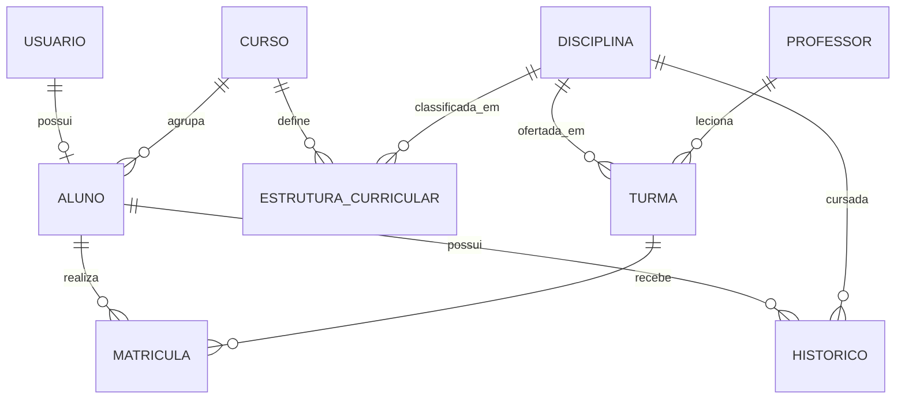

# Modelagem física — Sistema de Matrícula CINCoders

**Versão documental:** 1.0 — revisão para entrega
**Atualizado em:** 23/11/2026
**ORM:** Prisma ORM 7.10.1
**Banco:** SQLite, com `@prisma/adapter-better-sqlite3`
**Fonte executável de verdade:** `apps/api/prisma/schema.prisma` — conteúdo integral conferido com o responsável em 23/11/2026
**Migração inicial conhecida:** `apps/api/prisma/migrations/20261121010456_init/migration.sql`

> **Conferência concluída:** o responsável enviou o `schema.prisma` integral em 23/11/2026. Foram conferidos os nove modelos, quatro enums, chaves, relações, índices, valores padrão e políticas `onDelete: Restrict`. A descrição abaixo corresponde ao schema enviado, sem pressupor índices ou validações que ele não declara.

## 1. Objetivo e limites

O banco persiste usuários, cursos e currículos, professores, disciplinas, turmas do **único semestre corrente**, matrículas e histórico acadêmico. O modelo permite verificar vagas, restrições de matrícula e progresso sem criar tabelas para vários períodos letivos.

**Não existem telas de cadastro para cursos, alunos ou histórico de aprovação/reprovação:** esses dados são disponibilizados pelo seed de desenvolvimento. A secretaria administra disciplinas, professores e turmas; os alunos operam suas próprias matrículas.

## 2. Entidades e campos usados pela aplicação

| Entidade | Campos essenciais conhecidos | Papel |
| --- | --- | --- |
| `Usuario` | `id: Int`, `username: String`, `nome: String`, `senhaHash: String`, `perfil: PerfilUsuario` | Login e distinção entre `ALUNO` e `SECRETARIA` |
| `Aluno` | `id: Int`, `usuarioId: Int`, `cursoId: Int` | Vínculo entre conta de aluno e curso |
| `Curso` | `id: Int`, `nome: String`, `chMinObrigatoria: Int`, `chMinPerfil: Int`, `chMinLivre: Int` | Cargas horárias mínimas para conclusão |
| `Disciplina` | `id: Int`, `codigo: String`, `nome: String`, `cargaHoraria: Int` | Catálogo acadêmico |
| `EstruturaCurricular` | `cursoId: Int`, `disciplinaId: Int`, `categoria: CategoriaCurricular` | Classificação de disciplina no contexto de um curso |
| `Professor` | `id: Int`, `nome: String`, `email: String` | Responsável pelas turmas |
| `Turma` | `id: Int`, `disciplinaId: Int`, `professorId: Int`, `vagasTotais: Int` | Oferta de disciplina com professor e capacidade |
| `Matricula` | `id: Int`, `alunoId: Int`, `turmaId: Int`, `situacao: SituacaoMatricula`, `criadaEm: DateTime`, `canceladaEm: DateTime?` | Inscrição do aluno e preservação de cancelamentos |
| `Historico` | `id: Int`, `alunoId: Int`, `disciplinaId: Int`, `situacao: SituacaoHistorico` | Aprovações e reprovações de semestres anteriores |

Todos os campos `id` individuais usam `@id @default(autoincrement())`; a exceção é `EstruturaCurricular`, identificada pela chave composta.

### Enums declarados

| Enum | Valores persistidos |
| --- | --- |
| `PerfilUsuario` | `SECRETARIA`, `ALUNO` |
| `CategoriaCurricular` | `OBRIGATORIA`, `ELETIVA_PERFIL` |
| `SituacaoMatricula` | `ATIVA`, `CANCELADA` |
| `SituacaoHistorico` | `APROVADA`, `REPROVADA` |

**A categoria `LIVRE` não existe no enum Prisma:** é uma classificação calculada pela aplicação para disciplinas sem vínculo na estrutura do curso.

### Unicidades e vínculos conhecidos

- `Usuario.username` é único, e a aplicação exige hash de senha.
- `Aluno` se relaciona **1:1** com `Usuario` para contas de alunos. A secretaria é um `Usuario` de perfil `SECRETARIA`, sem entidade específica de secretaria.
- `Disciplina.codigo` é único.
- `Professor.email` é único.
- O par `(cursoId, disciplinaId)` é a **chave primária composta** de `EstruturaCurricular` (`@@id([cursoId, disciplinaId])`).
- `Turma` referencia uma disciplina e um professor.
- `Matricula` referencia o aluno e a turma; sua disciplina é obtida por meio da turma.
- `Historico` referencia aluno e disciplina, sem exigir turma histórica.

**Não pressupor unicidade de `Turma` por professor/disciplina:** o seed procura uma combinação existente para evitar duplicar seus dados iniciais, mas isso não representa necessariamente uma restrição declarada no banco para toda a aplicação.

### Índices e restrições expressos no schema

| Modelo | Chaves, unicidades e índices |
| --- | --- |
| `Usuario` | `id` primário; `username @unique` |
| `Curso` | `id` primário; `nome` sem unicidade declarada |
| `Aluno` | `id` primário; `usuarioId @unique`; `@@index([cursoId])` |
| `Disciplina` | `id` primário; `codigo @unique` |
| `EstruturaCurricular` | `@@id([cursoId, disciplinaId])`; `@@index([disciplinaId])` |
| `Professor` | `id` primário; `email @unique` |
| `Turma` | `id` primário; `@@index([disciplinaId])`; `@@index([professorId])` |
| `Matricula` | `id` primário; `@@index([alunoId, situacao])`; `@@index([turmaId, situacao])`; **nenhum** `@@unique([alunoId, turmaId])` |
| `Historico` | `id` primário; `@@index([alunoId, disciplinaId])`; `@@index([alunoId, situacao])` |

Todas as relações com chaves estrangeiras explícitas usam `onDelete: Restrict`. Assim, a API deve respeitar vínculos existentes em vez de depender de exclusões em cascata.

`Matricula.situacao` possui `@default(ATIVA)` e `Matricula.criadaEm` possui `@default(now())`. `canceladaEm` é opcional e é preenchido quando ocorre cancelamento.

## 3. Relacionamentos principais



O diagrama representa **relações de domínio**. A cardinalidade de matrícula histórica permite múltiplas linhas para o mesmo aluno e disciplina/turma ao longo de cancelamentos e novas matrículas.

## 4. Categorias curriculares

`EstruturaCurricular` relaciona curso e disciplina, com categoria:

- `OBRIGATORIA`: conta para carga horária obrigatória daquele curso.
- `ELETIVA_PERFIL`: conta para o grupo de eletivas de perfil daquele curso.
- **Sem vínculo na estrutura do aluno**: a disciplina é classificada como `LIVRE` para esse aluno.

O mesmo código de disciplina pode ser obrigatório em um curso e eletiva de perfil em outro. A categoria não deve ser gravada como atributo global da disciplina.

### Cálculo do progresso

1. Somar CH **aprovada** no histórico e desconsiderar reprovações.
2. Considerar o limite de CH de perfil exigida; o excedente aprovado em perfil pode ser contabilizado em livres.
3. Contabilizar separadamente a CH das matrículas ativas **em curso**, sem tratá-la como aprovação.
4. Limitar os percentuais de conclusão a 100% e a CH faltante a zero como mínimo.
5. Usar o curso do aluno autenticado na consulta, nunca um identificador de outro aluno escolhido pelo navegador.

## 5. Turmas e capacidade

Cada turma contém a capacidade total `vagasTotais`. A ocupação **não é armazenada em coluna duplicada**: a API calcula a quantidade de matrículas cujo `turmaId` é o da oferta e cuja `situacao` é `ATIVA`.

```text
vagasOcupadas    = contagem(Matricula onde turmaId = turma.id e situacao = ATIVA)
vagasDisponiveis = vagasTotais - vagasOcupadas
```

### Restrições de domínio

- A capacidade inicial deve ser um inteiro positivo.
- A secretaria pode aumentar ou reduzir a capacidade, desde que nunca fique abaixo da ocupação ativa.
- A capacidade pode ser **igual** à ocupação; nessa condição, a turma está lotada.
- Uma matrícula cancelada não ocupa mais vaga.
- As operações devem preservar a capacidade sob chamadas concorrentes.

**Estratégia implementada na matrícula:** os trechos de `matriculas.service.ts` compartilhados usam transação Prisma e uma atualização de escrita da turma antes de verificar disponibilidade. O objetivo é serializar verificações e evitar duas matrículas na última vaga com SQLite. Os testes de concorrência da API foram relatados como aprovados; isso não substitui uma avaliação para outros bancos ou implantação distribuída.

## 6. Matrículas ativas e canceladas

O modelo mantém os registros na mesma entidade `Matricula` e utiliza o campo `situacao`:

| Situação | Consequência |
| --- | --- |
| `ATIVA` | Participa da ocupação da turma e da CH em curso |
| `CANCELADA` | Não participa mais da ocupação; preserva trilha histórica e a data de cancelamento |

### Unicidade por disciplina

O aluno **não pode possuir duas matrículas ativas em turmas da mesma disciplina**, mesmo com IDs de turma diferentes.

Essa restrição não é garantida apenas por `alunoId` e `turmaId`: para verificá-la, a aplicação considera a disciplina associada à turma de cada matrícula ativa.

### Rematrícula

Quando o aluno cancela uma matrícula elegível e volta a se matricular:

1. O registro anterior continua como `CANCELADA`, com `canceladaEm`.
2. Uma nova linha é criada como `ATIVA`, com novo identificador e data de criação.
3. A regra de aprovação anterior, a lotação e a proibição de matrícula ativa duplicada continuam válidas.

**Não adicionar `@@unique([alunoId, turmaId])` de forma irrestrita:** isso impediria uma nova matrícula na mesma turma depois do cancelamento, contrariando a [ADR-0001](adr/0001-rematricula-novo-registro.md). Também não resolveria a unicidade por **disciplina** definida na [ADR-0002](adr/0002-unicidade-matricula-ativa-por-disciplina.md).

## 7. US-13 — Histórico de cancelamentos

O requisito funcional adicional escolhido utiliza os **registros `CANCELADA` já persistidos na tabela `Matricula`**. Não é necessária uma entidade “Histórico de cancelamentos” separada: o `Historico` já existente representa aprovações/reprovações de disciplinas cursadas, que são outro conceito.

### Consulta

- **Endpoint:** `GET /api/aluno/matriculas/historico`.
- **Filtro de titularidade:** aluno identificado pela sessão autenticada.
- **Filtro de situação:** somente `CANCELADA`.
- **Dados apresentados:** disciplina, turma, professor, informações da matrícula e data de cancelamento, quando disponível.
- **Navegação:** paginação e ordenação estável.
- **Sem exclusão:** cancelar não apaga a linha; o histórico de cancelamento continua acessível.

**Evidências compartilhadas:** 10 testes API dedicados em `matriculas.historico.test.ts`, 9 testes frontend em `HistoricoMatriculas.test.tsx` e 8 verificações manuais da US-13. Esses testes estão incluídos nos totais globais e não devem ser somados novamente.

## 8. Restrições que pertencem ao backend

O Prisma representa relações, chaves e unicidades declaradas. As regras abaixo exigem validação da aplicação e, quando cabível, estratégia transacional:

| Regra | Validação necessária |
| --- | --- |
| CH de disciplina | Entre 15 e 120 horas, múltipla de 15 |
| Código/e-mail | Não permitir duplicidade de código de disciplina ou e-mail de professor |
| Abertura de turma | Disciplina/professor existentes e capacidade positiva |
| Alteração de turma | Nova capacidade ≥ matrículas ativas |
| Matrícula | Não aprovada anteriormente; sem outra matrícula ativa na disciplina; vaga disponível |
| Concorrência | Evitar duas matrículas na última vaga |
| Cancelamento | Matrícula própria e ativa; atualizar situação e `canceladaEm` sem exclusão |
| Consulta acadêmica | Perfil autorizado e titularidade derivada da sessão |
| Progresso | Classificação por curso, excedente de perfil, reprovação/CH em curso e limites |
| Histórico US-13 | Apenas registros cancelados do próprio aluno, com paginação validada |

Não presumir que ocultar um botão na interface impeça uma operação indevida: a validação é obrigatória no servidor.

## 9. Migração, configuração e carga inicial

### Arquivos de infraestrutura

```text
apps/
  api/
    prisma/
      schema.prisma
      migrations/
        20261121010456_init/
          migration.sql
      seed.ts
    prisma7.config.ts
    .env.example
    src/
      config/database.ts
      generated/prisma/          (gerado, não versionado)
docs/
  modelagem-fisica.md
  adr/
    0001-rematricula-novo-registro.md
    0002-unicidade-matricula-ativa-por-disciplina.md
    0003-autenticacao-por-sessao.md
```

### Preparar desenvolvimento em `apps/api/`

Depois de instalar as dependências e configurar `.env` local:

```powershell
pnpm install
pnpm exec prisma validate
pnpm exec prisma migrate deploy
pnpm exec prisma generate
pnpm exec prisma db seed
pnpm exec tsc --noEmit
```

As variáveis necessárias são:

```dotenv
DATABASE_URL="file:./dev.db"
SESSION_SECRET=""
SEED_PASSWORD=""
PORT=3001
```

**Antes de executar o seed**, preencher `SESSION_SECRET` com pelo menos 32 caracteres e `SEED_PASSWORD` com pelo menos 12 caracteres em `apps/api/.env` local, sem versionar os valores. O seed é destinado a desenvolvimento e testes, não a dados reais de produção.

### Banco dedicado de testes

O responsável confirmou que `test.db` existe e executou a suíte API com `DATABASE_URL=file:./test.db` e `--no-file-parallelism`, obtendo **133/133 testes aprovados em 11 arquivos**. Em seguida removeu a variável temporária e confirmou `file:./dev.db` como configuração de desenvolvimento.

Não executar testes de integração com `dev.db` nem usar comandos de exclusão/recriação de banco sem verificar o alvo e obter autorização.

### Carga inicial conhecida

| Dado | Quantidade |
| --- | ---: |
| Cursos | 3 |
| Alunos | 4 |
| Usuário de secretaria | 1 |
| Disciplinas | 6 |
| Professores | 2 |
| Turmas | 7 |
| Vínculos curriculares | 11 |
| Registros de aprovações/reprovações | 8 |
| Matrículas ativas criadas pelo seed | 0 |

O seed procura entidades existentes antes de criá-las e foi executado com sucesso na base de desenvolvimento e numa base separada de validação do README.

## 10. Evolução, decisões e verificação final

| Assunto | Documento relacionado |
| --- | --- |
| Rematrícula como novo registro | [ADR-0001](adr/0001-rematricula-novo-registro.md) |
| Uma matrícula ativa por disciplina | [ADR-0002](adr/0002-unicidade-matricula-ativa-por-disciplina.md) |
| Sessão autenticada | [ADR-0003](adr/0003-autenticacao-por-sessao.md) |
| Endpoint e serviços | [Visão geral da arquitetura](arquitetura/visao-geral.md) |
| Cenários automatizados/manuais | [Plano de testes](testes/plano-de-testes.md) |
| Instalação do zero | [README](../README.md) |

### Verificações documentais concluídas

- [x] Conferidos todos os modelos, campos, enums, valores padrão, índices e relacionamentos com o `schema.prisma` integral enviado.
- [x] Conferida a ausência de `@@unique([alunoId, turmaId])`, necessária para permitir rematrícula após cancelamento.
- [x] Conferidos os índices de consulta das matrículas `ATIVA`/`CANCELADA`, compatíveis com a US-13.
- [x] Migração `20261121010456_init` aplicada com sucesso no banco SQLite novo de validação do README, segundo log compartilhado.
- [x] Prisma Client 7.10.1 gerado e seed executado no banco novo, conforme log compartilhado.
- [x] Confirmado no `git status --short` anteriormente mostrado que bancos locais, `.env` e Client gerado não constavam entre os arquivos modificados ou não rastreados apresentados.
- [x] Responsável confirmou que o usuário avaliador `selecaogersist` **aceitou o convite de acesso** ao GitLab.

**Estado documental:** modelagem física **conferida com o schema enviado e pronta para versionamento**. A revisão do índice de arquivos efetivamente adicionados e a publicação do commit são procedimentos de Git executados depois de copiar estes documentos ao repositório Windows.
